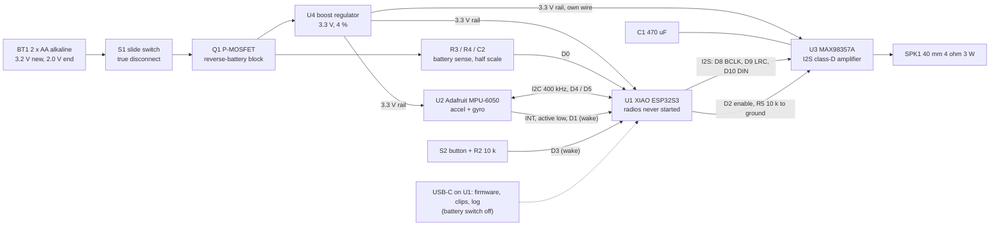
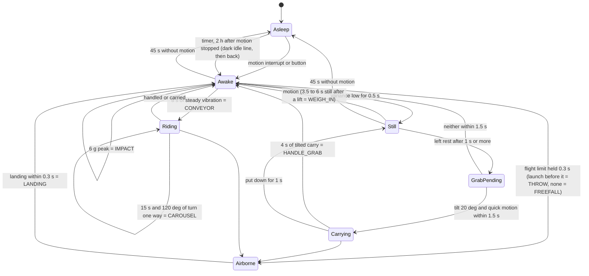

# Baggage Claims MK1: the device, 2 x AA design (Rev B)

22 November 2026. Device engineering for the seeded example, after the owner's rulings of that day: two AA alkaline cells, a physical off switch, the Adafruit MPU-6050 breakout as the sensor, detection rules "as a real engineer would set them", an Arduino sketch, and the prototype costs added up.

**Nothing here has been built or measured.** Every figure carries one of these marks:

| Mark | Meaning |
|---|---|
| [doc] | stated in the owner's Rev A documents (`seed/concepts/baggage-claims/files`) |
| [page] | read on a maker's or reseller's page or data sheet on 22 Nov 2026 (listed in section 9) |
| [recalled] | a data-sheet figure from memory, not re-read on 22 Nov; check before relying on it |
| [calc] | calculated here from the figures beside it |
| [est] | an engineering estimate; the basis is given |
| [host] | shown by the host tests in `tests/firmware` (synthetic traces on a PC, not hardware) |

Companion files: the firmware (`BaggageClaims_MK1_RevB.ino`, `bc_detect.h`, `bc_detect.cpp`, the partitions file, all in the example's Files), the host tests (`tests/firmware`), the app rows (`seed/concepts/baggage-claims/content/2026-11-22-engineering.json`), the envelope for the enclosure (`docs/design/baggage-claims-device-envelope.json`) and the rows of the owner's list this settles (`docs/research/baggage-claims-engineering-resolutions.md`).

## 1. Summary

- **Power.** Two AA cells cannot run the Rev A design: its bus is 4.5 to 4.9 V [doc] and two cells give 3.2 V new and 2.0 V at the end [est]. The design chosen is a **3.3 V boost regulator feeding one rail**, with an ESP32-S3 board that takes 3.3 V directly, an I2S class-D amplifier in place of the DFPlayer, clips in the controller's flash in place of the microSD card, and a 4 ohm speaker in place of the 8 ohm one.
- **Throw.** Launch, then flight, then landing. The flight test allows for spin, because a tag on the handle of a tumbling bag never reads zero g. Section 3.3.
- **Carousel.** At least 15 s of quiet transport with at least 120 degrees of turn one way about the vertical. Section 3.6.
- **Battery life.** About 6 months at four travel days a month [est]. Section 2.6.
- **What two AA cells do not meet.** Loudness: about 80 dB at 1 m against the documents' "~85 dBA" [calc], and Rev A as drawn would be no louder. Sleep current: about 0.25 mA against the documents' "<200 uA" [est], which Rev A's parts could not meet either. The 128 clips in each of three packs, and packs sold as a card: not in this build. Section 2.11.
- **Firmware.** The detection logic passes 26 host tests [host]. arduino-cli compiles and links the whole sketch for the XIAO ESP32S3 with core 4.0.0 (418,264 bytes, no warning in the sketch's files), with one step stood in for: Arduino's ctags, which could not be downloaded. Nothing has run on a board. Section 4.
- **Cost.** The documents' parts list adds up to $64.80 [doc]; the 2 x AA design comes to $72.83 for one, $72.83 each for five and $62.69 each for a hundred [est]. Section 5.

## 2. Electrical design

### 2.1 Block diagram

### 2.2 What two AA cells do to each part of Rev A

Two alkaline cells in series: about 3.2 V open circuit when new, 3.0 V nominal, 2.4 V at 1.2 V a cell, 2.0 V at 1.0 V a cell, which is taken as the end of useful life [est, typical alkaline discharge]. Under a 0.5 A pulse old cells sag a further 0.2 to 0.4 V [est].

| Rev A part | What it needs | On 2 x AA | Verdict |
|---|---|---|---|
| U1 Waveshare ESP32-S3 Mini on VIN, on-board regulator | 4.5 to 4.9 V bus [doc]; the chip itself 3.0 to 3.6 V [recalled] | The regulator can only drop voltage: its output would be under 3.0 V from the first day | Does not run |
| U2 GY-521 MPU-6050 | Sensor 2.375 to 3.46 V [recalled], through the board's own regulator | Works while the cells are above about 2.5 V, then out of specification: roughly the second half of the cells' energy is unusable [est] | Marginal |
| U3 DFPlayer Mini | 3.2 to 5 V [page: the app's part library, from the maker's wiki]; the build guide says "4.5-5 V - NOT 3.3 V" [doc]; standby about 20 mA [recalled] | Below its minimum for nearly the whole life of the cells. Its standby alone would empty two AA cells in about four days, on any battery | Does not run |
| SPK1 8 ohm 3 W | Power is set by the supply: a bridged amplifier gives about V^2 / 2R | About 0.6 W at 3.3 V into 8 ohm [calc] | Quiet |
| SD1 microSD | 2.7 to 3.6 V [recalled] | Out of range below 2.7 V; only exists as part of the DFPlayer | Goes with U3 |
| Sleep current "<200 uA" [doc], "30-60 uA" [doc] | | Rev A could not meet it on any cells: the DFPlayer is always powered from VIN and idles at about 20 mA [recalled] | Rev A claim does not hold |

So a regulated rail is needed, and the audio path has to change whatever else is chosen.

### 2.3 Options compared

Cost is for the parts that differ, one unit [est]. Loudness is the peak level at 1 m with a 40 mm speaker of 80.5 dB at 1 W and 1 m [page]. Peak battery current is at 2.0 V.

| | A. Boost to 5 V, keep Rev A's modules | **B. Boost to 3.3 V, I2S amplifier, clips in flash (chosen)** | C. No regulator: everything straight from the cells |
|---|---|---|---|
| Parts that differ | 5 V boost module ($4), a load switch for the DFPlayer ($2), Rev A's board, DFPlayer, card | 3.3 V boost module ($5.75), XIAO ESP32S3 ($7.49), MAX98357A board ($5.95), 4 ohm speaker ($4.95) | A controller that runs from 1.8 V (not an ESP32), MAX98357A, no regulator |
| Cost against Rev A | about +$6 | about +$8 (with the Adafruit sensor the owner chose) | about -$2 |
| Size | Largest: three boards plus two more | Smallest: four thumb-size boards, no card | Smallest |
| Sleep current at the battery | The DFPlayer must be switched off by a load switch or it takes 20 mA; then about 0.4 mA through a 5 V boost [est] | about 0.25 mA (section 2.5) [est] | Lowest, about 0.05 mA [est] |
| Loudness | 1.0 W into 8 ohm at 5 V: 80 dB. With a 4 ohm speaker 2.5 W: 84 dB, **if the cells could supply it** [calc] | 1.0 W into 4 ohm: 80 dB [calc] | Falls with the cells: 0.85 W new, under 0.4 W at 2.0 V; amplifier stops at 2.5 to 2.7 V [calc, page] |
| Peak battery current | 0.75 A for 1 W; 1.8 A for 2.5 W, which old AA cells cannot give [calc] | about 0.7 A for 1 W [calc] | about 0.5 A |
| Wake-to-sound time | DFPlayer needs 1 to 2 s after power-up to read its card [est]: fails "impact gag within 1 s" [doc] | Under 0.3 s [est] | Under 0.3 s |
| Risk | DFPlayer clones differ; card contacts in a dropped bag; two regulators in series | Clips limited to what the flash holds; sleep current rests on the boost module's own draw | The sensor leaves its specification below 2.4 V; flash and amplifier limits near 2.5 to 2.7 V; half the cells' energy unused |

**Chosen: B.** It is the only one that keeps every part inside its supply range for the whole life of the cells, starts a clip within the documents' one second, and does not ask old cells for more current than they can give. A loses on the DFPlayer (standby current, start-up time, a card in a product that gets thrown). C is the cheapest and sleeps best, but it would mean a different controller family and a sensor run out of specification, against the ruling that the Adafruit MPU-6050 breakout is the base.

Why these parts:

- **U1, Seeed Studio XIAO ESP32S3.** Same ESP32-S3 family as Rev A, so the documents' "radios off, no RF certification scope" argument stands. 21 x 17.5 mm [page], 8 MB flash [page], deep sleep 14 uA by its maker's claim [page, conditions not stated]. It has no always-powered RGB LED, which several other small ESP32-S3 boards have and which alone would break the sleep budget [est]. Eleven pins; nine used.
- **U3, MAX98357A breakout.** 2.7 to 5.5 V [page], needs no master clock [page], drives the speaker directly. Shut down by its SD pin.
- **U4, 3.3 V step-up module of the Pololu U1V11F3 class.** 0.5 to 5.5 V in, 3.3 V out at 4 %, switch limit typically 1.2 to 1.5 A, regulates down when the input is above 3.3 V [all page]. At 2.0 V in, a 1.2 A switch limit gives about 0.6 A at 3.3 V [calc, 85 % efficiency assumed], against a need of about 0.4 A.
- **SPK1, 40 mm 4 ohm 3 W cone speaker.** 4 ohm doubles the power available from a fixed 3.3 V.
- **Clips in flash.** 5.9 MB of the controller's 8 MB hold about 190 s of 16-bit mono audio at 16 kHz [calc]: the ten starter clips [doc] in three packs fit.

### 2.4 Protection, the off switch, brown-out

- **Off switch (S1).** In the battery's positive lead, before everything. Off, nothing is connected to the cells: current is zero, not a sleep current. This is the ruling's "in case the airport asks for it to be disabled". The switch must be rated 1 A or more at 6 V DC: the regulator draws about 0.7 A from nearly flat cells during a loud clip [calc]; the common sub-miniature slide switches are rated 0.3 A [est].
- **Reverse battery (Q1).** A P-channel MOSFET, drain to the switch, source to the regulator, gate to ground. With the cells the right way round it is on and drops about 0.07 V at 0.7 A for a 0.1 ohm part [calc]; reversed, it blocks. A diode would cost 0.3 V of a 2.0 V supply. The part must be fully on at 1.8 V gate drive.
- **Brown-out.** If the rail dips during a clip the ESP32-S3's brown-out detector resets it [recalled]. The firmware counts brown-out resets in memory that survives them: after one it plays 6 dB quieter, after two it plays nothing until the cells are changed (a power-on reset clears the count). C1, 470 uF at the amplifier, carries the peaks of speech.
- **ESD.** The case is plastic and nothing conductive is exposed: the switch slider and the button are plastic, the USB port is inside the lid. The path left is an air discharge through a grille hole to the speaker frame; keep 4 mm of air or the fabric mesh between any opening and metal [est]. No ESD test has been done.
- **USB and battery together.** With the switch on, never plug in USB: the board's regulator and U4 would both drive the 3.3 V rail. Flash and load clips with the switch off. (Rev A had the same rule for a different reason [doc].) Whether U4 tolerates 3.3 V on its output with no input is **not verified**; check on the bench with a current-limited supply before the first USB session.

### 2.5 Power budget

All on the 3.3 V rail unless marked; "at the battery" converts at 2.6 V average.

| State | Load | Current | Basis |
|---|---|---|---|
| **Asleep** | ESP32-S3 board in deep sleep | 14 uA | [page], maker's claim |
| | MPU-6050, accelerometer only, 5 wake-ups a second | 20 uA | [recalled] |
| | Sensor board's own regulator | about 55 uA | [est]: the regulator type on the board was not confirmed |
| | Amplifier shut down | 2 uA | [recalled] |
| | Sum on the rail | 91 uA | [calc] |
| | At the battery: rail load at about 60 % light-load efficiency, plus the boost's own 55 uA, plus the 1.5 uA divider | **about 0.25 mA** (0.2 to 0.4) | [est] |
| **Awake, watching** | Sensor at 100 Hz, both accel and gyro | 3.8 mA | [recalled] |
| | Controller: 80 MHz, awake about 8 % of the time to empty the sensor's FIFO, light sleep between | about 2.5 mA | [est]: 30 mA active, 0.24 mA light sleep [recalled] |
| | At the battery, 85 % efficiency | **about 9 mA** | [calc] |
| **Playing** | Amplifier, speech at full volume: average about 0.25 W, peaks 1.0 W | 90 mA average, 350 mA peak | [est] |
| | Controller awake | 30 mA | [recalled] |
| | At the battery | about **0.2 A average, 0.7 A peak** at 2.0 V | [calc] |

Two unknowns dominate the sleep figure and both are on the bench-test list: the boost module's no-load current (its maker says only "under 1 mA" [page]; the chip family's data sheet says about 55 uA [recalled]) and the sensor board's regulator. If the sensor board carries a power LED it must be cut or the sleep current roughly quadruples [est]; the pages read do not mention one.

Sleep and wake: after 45 s with no motion the firmware puts the sensor into its low-power accelerometer cycle with the motion interrupt armed, and the controller into deep sleep. The interrupt line or the button wakes it; sampling restarts about 0.2 s later [est]. A drop that begins from complete rest is therefore caught only at its landing (as a hard impact); a throw is preceded by handling, so the device is already awake.

### 2.6 Battery life

Usable capacity: 2,000 mAh from two AA alkaline cells in series, down to 1.0 V a cell, with pulsed loads [est; a new AA is about 2,500 mAh at low drain].

Profile of **one travel day** [est, stated so it can be argued with]: 3 h awake in total (the drive, check-in, belts, loading, taxi and take-off, landing, the carousel, the drive home), six clips of 3 s, 21 h asleep. The cruise is assumed too smooth to wake it; that is the largest uncertainty.

| | Per day |
|---|---|
| Awake 3 h at 9 mA | 27 mAh |
| Six clips, 18 s at 0.2 A | 1 mAh |
| Asleep 21 h at 0.25 mA | 5 mAh |
| **A travel day** | **about 33 mAh** |
| A day at home, switched on, asleep | 6 mAh |

| Use | Per month | Life of a set |
|---|---|---|
| Four travel days a month | 290 mAh | **about 7 months, say 6** |
| Eight travel days a month | 400 mAh | about 5 months |
| Switched on, never moved | 180 mAh | about 11 months |
| If the cruise keeps it awake 8 h more per flight day | 580 mAh at four days | about 3.5 months |

The documents ask for "3-6 months per battery set" [doc]: met on these estimates, with the last line as the bad case. Without the FIFO batching (controller awake all the time, about 50 mA at the battery) the four-day figure falls to under 3 months, which is why the firmware batches.

### 2.7 Audio and loudness

- Amplifier output on a 3.3 V rail: about 1.0 W into 4 ohm, 0.6 W into 8 ohm, at the onset of clipping [calc: peak swing 0.87 and 0.93 of the rail]. The amplifier's own page gives figures only for 5 V (3.2 W into 4 ohm, 1.8 W into 8 ohm, at 10 % distortion) [page].
- A 40 mm 4 ohm 3 W paper-cone speaker: 86 +/- 3 dBA at 1 W and 0.5 m, 80.5 dB at 1 W and 1 m [page: one maker's data sheet]. Thin mylar speakers of 5 mm depth are typically 8 to 10 dB less sensitive [est].
- **Level at 1 m, full volume, new cells: about 80 dB (77 to 84) [calc].** The documents state "~85 dBA @1m" as the level and "<=85 dBA @ 1 m" as the ceiling [doc]. The ceiling is met. The level is about **5 dB short**. Reaching 85 dB needs about 3 W into this speaker, which is 4 ohm on 5 V; two nearly flat AA cells would have to give 1.8 A [calc], which they cannot.
- Rev A as drawn (8 ohm on a DFPlayer at about 4.7 V) comes to about 1 W and the same 80 dB [calc]. The "3 W" in the documents is the module's rating into 4 ohm at 5 V, not what that speaker would get.
- Volume: three steps, 0, -5 and -10 dB, applied in firmware [design]. Gain pin left open: 9 dB [page]; clips mastered to peak near full scale.

### 2.8 Pin map and wiring

Pin names and GPIO numbers are from the Arduino-ESP32 core's own file for the board [page: `variants/XIAO_ESP32S3/pins_arduino.h`, core 4.0.0].

| Net | XIAO pin (GPIO) | To | Type | Notes |
|---|---|---|---|---|
| BATT_SENSE | D0 (1) | midpoint of R3 / R4, C2 to ground | analog in | half the battery voltage; 1 M + 1 M draws 1.5 uA |
| MPU_INT | D1 (2) | U2 INT | in, wake | active low, latched until the status register is read |
| AMP_SD | D2 (3) | U3 SD, R5 10 k to ground | out | high while a clip plays; R5 keeps the amplifier off while the controller sleeps |
| MODE | D3 (4) | S2 to ground, R2 10 k to 3V3 | in, wake | active low; debounce 30 ms |
| I2C_SDA | D4 (5) | U2 SDA | I2C | 10 k pull-up on the sensor board [page] |
| I2C_SCL | D5 (6) | U2 SCL | I2C, 400 kHz | address 0x68 [page] |
| I2S_BCLK | D8 (7) | U3 BCLK | out | |
| I2S_LRC | D9 (8) | U3 LRC | out | |
| I2S_DIN | D10 (9) | U3 DIN | out | |
| 3V3 | 3V3 | U4 VOUT; also U2 VIN, R2 | power | U3 Vin on its own wire from U4 VOUT |
| GND | GND | star at U4 GND | ground | |
| spare | D6 (43), D7 (44) | | | serial port pins, left free |

Power path: BT1 + to S1, S1 to Q1 drain, Q1 source to U4 VIN and R3; Q1 gate, BT1 - and every ground to U4 GND. The app's Schematic holds every wire (34), and its electrical checks report no error and no warning on them (before: no error, two warnings about the GY-521's pull-ups).

### 2.9 Interfaces

| # | Name | Ends | Type |
|---|---|---|---|
| IF-1 | POWER | BT1, S1, Q1 to U4 | 2.0 to 3.2 V DC; 0.25 mA asleep, 9 mA awake, 0.7 A peak [est] |
| IF-2 | RAIL | U4 to U1, U2, U3 | 3.3 V, 4 % [page]; 0.4 A peak [est] |
| IF-3 | I2C | U1 to U2 | 400 kHz, address 0x68, registers as in section 3.1 |
| IF-4 | I2S | U1 to U3 | 16-bit, 16 kHz, both channels carrying the same samples; no master clock |
| IF-5 | AUDIO | U3 to SPK1 | bridged class-D, 4 ohm, about 1 W; neither lead grounded |
| IF-6 | INT | U2 to U1 D1 | active low, latched, wakes from deep sleep |
| IF-7 | MODE | S2 to U1 D3 | active low, wakes from deep sleep |
| IF-8 | BATT_SENSE | divider to U1 D0 | half scale, read 8 times and averaged |
| IF-9 | USB-C | PC to U1 | firmware, clips, 115200 baud log; battery switch off |
| IF-10 | MECH | tag to the suitcase handle | the enclosure's loop (section 6) |

### 2.10 Audio at low battery

The battery is read awake and silent. Per cell these are 1.2, 1.1 and 1.0 V; Rev A's single threshold (3.3 V for three cells [doc]) is the same 1.1 V a cell as the second step.

| Battery | Behaviour |
|---|---|
| 2.4 V and above | Normal |
| under 2.4 V | Clips 3 dB quieter (halves the peak current) |
| under 2.2 V | 6 dB quieter, and the low-battery line ("I... hun...ger" [doc]) once |
| under 2.0 V, or under 1.8 V during a clip, or two brown-out resets | No clips. The device still wakes and sleeps, so new cells bring it back without any action |

The "rasp" in the documents is a recorded clip. An unintended rasp, the amplifier clipping as the rail sags, is what the two quieter steps are there to prevent. 60 mV of hysteresis stops the level flapping. Alkaline cells left in a device after they are flat can leak; the compliance card should say to take them out.

### 2.11 What two AA cells cannot meet, exactly

| Requirement in the documents | 2 x AA design | Short by |
|---|---|---|
| "~85 dBA @1m" [doc] | about 80 dB at 1 m [calc] | about 5 dB (1 to 8). Rev A as drawn: the same |
| "sleep current <200 uA" [doc]; "30-60 uA" [doc] | about 0.25 mA [est] | about 0.05 mA over the first; four to eight times the second. Rev A as drawn: about 20 mA |
| "1.8A audio peak" [doc] as a supply figure | 0.7 A peak [calc] | Not needed at 1 W; not available from old AA cells |
| 128 clips in each of three packs on a card [doc] | about 190 s of clips in flash, three packs of ten clips [calc] | 128 clips of 3 s at 16 kHz are 12 MB a pack; the flash holds 5.9 MB in all. Packs sold as a card are not possible without a card socket |
| "3-6 months per battery set" [doc] | about 6 months at four travel days a month [est] | Met on the estimate |
| Impact gag within 1 s [doc] | under 0.3 s when awake [est] | Met on the estimate |

## 3. Detection specification

### 3.1 Sensor settings

| Setting | Value | Why |
|---|---|---|
| Sample rate | 100 Hz [doc] | Kept |
| Accelerometer range | **+/-16 g** | Resolves the Rev A conflict: hard impact is "8-14 g" [doc] on a "+/-8 g" range [doc], which cannot read above 8 g on an axis |
| Gyro range | +/-2000 deg/s | A tossed bag tumbles at 200 to 700 deg/s [est]; Rev A's +/-500 would clip |
| Filter | DLPF 2: 94 Hz accel, 98 Hz gyro [recalled] | Rev A's 42 or 44 Hz filter flattens a 10 ms impact to a fraction of its peak |
| Read-out | FIFO, emptied every 200 ms (20 ms while a flight may be in progress) | Lets the controller sleep between batches |
| Asleep | Accelerometer only, 5 wake-ups a second, motion interrupt at about 80 mg | Threshold register units differ between InvenSense documents (2 mg or 32 mg per step) [recalled]: confirm on the bench |
| Gyro offset | Up to 20 deg/s [recalled]; learnt at rest, never from a steady turn (anything over 6 deg/s away from the stored value is treated as rotation) [host] | A round carousel is a steady turn |

Features, per sample: |a| (the length of the acceleration vector); gravity, as a slow average taken only while |a| is within 0.12 g of 1 g; a fast average of the acceleration direction (0.3 s) for tilt while moving; dynamic acceleration (acceleration minus gravity); the turn rate after offset removal, and its part about gravity (yaw). Per 0.5 s: variance of each axis (stillness). Per 1 s: standard deviation of |a|, mean yaw rate, mean off-axis rate, zero crossings of |a| about the last second's mean.

### 3.2 Events, in priority order

| # | Event | Rule | Window and debounce |
|---|---|---|---|
| 1 | **Throw** | Launch, then flight (section 3.3) | Reported 0.3 s into the flight |
| 2 | **Free-fall** | Flight with no launch | Reported 0.3 s into the flight |
| 3 | Landing | 2.5 g or more within 0.3 s of a reported flight's end | Reported so a landing line can follow if nothing is playing; never a second gag on its own |
| 4 | **Hard impact** | Peak of 6 g or more | Not within 1.5 s of a flight (that is its landing); 1 s before the next |
| 5 | **Carousel** | Section 3.6 | Once per ride |
| 6 | **Weigh-in** | A lift of 0.25 g or more, stillness beginning within 3 s of it, stillness lasting 3.5 to 6 s [doc], then motion | Reported when the stillness ends |
| 7 | **Handle grab** | From 1 s of rest: tilt of 20 degrees and quick motion (0.3 g or 60 deg/s) within 1.5 s; then 4 s in which tilt from the rest attitude is 12 degrees or more for 70 % of the time and three of every four seconds show 0.04 to 0.6 g of bounce | Cancelled by 1 s of stillness or by a flight |
| 8 | **Conveyor / cart ride** | Seconds with 0.03 to 0.30 g of vibration, 8 or more zero crossings (a rhythm above 4 Hz, faster than walking), mean turn under 25 deg/s | 8 such seconds (a bad second counts as minus two); waits up to 12 s more if the ride is already turning, for the carousel decision |
| 9 | Inverted | The tag's "up" axis within 25 degrees of straight down | 4 s [doc] |
| 10 | **Dark hold idle** | No motion for 2 h [doc] | One timed wake from deep sleep, once per stop |
| - | **Button** | Tap: next volume step, or stop the clip that is playing. Hold 1.5 s: next voice pack. Hold 10 s: reset [doc] | 30 ms debounce |
| - | **Low battery** | Section 2.10 | Read every 30 s awake |

Stillness: the three axes' variances over 0.5 s sum to less than 0.0006 g^2 (0.025 g), the gyro's to less than 12 (deg/s)^2, and the turn rate is under 4 deg/s. Motion (which keeps the device awake): dynamic acceleration over 0.10 g or turn rate over 15 deg/s.

**Lock-outs.** A flight cancels a grab in progress. An impact within 1.5 s of a flight is not reported. While a clip plays, the speaker shakes the sensor, so stillness, weigh-in, grab, conveyor and carousel hold their state; flight and impact stay live, and anything they report is logged and refused as busy. The governor then applies the documents' rules [doc]: one gag per event class per journey phase (a phase ends after 60 min without motion), 3 s between gags, six an hour.

### 3.3 The best way to detect a throw

A throw has three parts, and each is needed to tell it from something else.

1. **Launch.** In the 0.6 s before the flight begins, |a| above 1.15 g adds up to at least 0.08 g-seconds (a velocity change of about 0.8 m/s), or one sample is above 2.0 g. A handler's swing is 1.5 to 3 g for 0.2 to 0.4 s [est], several times this. Walking bounce (1.2 to 1.4 g peaks) stays under it.
2. **Flight.** |a| stays under **0.35 g + 0.046 x (turn rate in rad/s)^2, the second term capped at 0.45 g**, for 0.3 s, with one sample's grace. The second term is the point. A thrown bag tumbles, and the tag sits on the handle up to about 0.45 m from the bag's centre, so it feels centripetal acceleration of (rate)^2 x radius: 0.37 g at 200 deg/s and 0.3 m [calc]. Rev A's fixed "|a| < 0.15 g" [doc] would miss most real throws [host: the same synthetic throw with the Rev A limit reports no flight].
3. **Landing.** 2.5 g or more within 0.3 s of the flight's end.

| Looks like a throw | Why it is not reported as one |
|---|---|
| A **drop** (slides off a cart, let go) | No launch: it is a free-fall, a different line [host] |
| Being **set down** | The dip is 0.6 to 0.9 g for 0.1 to 0.3 s: it never gets under the flight limit, let alone for 0.3 s [host] |
| **Conveyor vibration** | Swings about 1 g and crosses it many times a second; it cannot stay under 0.35 g for 30 samples running [host] |
| A short hop (under 0.3 s, 0.44 m of fall) | Not a flight by the owner's ruling; its bump is a hard impact if it reaches 6 g [host] |
| The tag knocking the case | Short 2 to 4 g spikes at 1 g: neither low for 0.3 s nor 6 g [host] |
| Swung hard on the ground at over 220 deg/s | **Can be mistaken** for a flight if |a| also drops under 0.8 g for 0.3 s. The cap on the spin allowance limits this; real recordings decide the cap |

The line starts in the air, 0.3 s into the flight, which is why the firmware polls every 20 ms once it sees low g.

### 3.4 Free-fall and hard impact

Free-fall: the owner's ruling is a duration over 0.3 s, which is a fall of 0.44 m. Hard impact: as in the documents, with the threshold at 6 g on the +/-16 g range. A 0.5 m drop of a packed case onto carpet stops in 15 to 25 mm, an average of about 20 g [calc]; the 94 Hz filter passes most of a 10 to 20 ms pulse, so 6 g leaves margin. The documents' acceptance test (0.5 m onto carpet, impact gag within 1 s) is a 0.32 s fall: it now reports a free-fall in the air and its landing, not a bare impact. Both lines are in the right family; the bench test text says which to expect.

### 3.5 Handle grab and weigh-in

Handle grab follows the ruling: tilt and quick motion, then sustained tilt plus steady carry accelerations. The gag comes about 4.5 s after the grab (Rev A waited 10 s [doc]); the documents' test (carry 15 s) passes with room. A case knocked over and left shows the tilt and the quick motion but no carry, and is not reported [host]. A case lifted straight up with no tilt at all is **not** reported: the ruling asks for tilt, and a tag on a loop nearly always changes attitude when its case is picked up, but this is the first thing to look at in recordings.

Weigh-in keeps the documents' 3.5 to 6 s. The added lift condition stops a case that was merely left alone, then nudged, from counting.

### 3.6 Carousel

**Method.** Turn about the vertical. The gyro vector is projected onto the direction of gravity, so it does not matter how the tag lies. A second counts as "turning" when its mean yaw rate is 4 to 60 deg/s, the rate about the other axes is under 20 deg/s (not tumbling), and |a| varies by less than 0.15 g (not carried or handled). Left and right turn are summed separately and fade with a 40 s memory.

**Report** when all three hold: 15 s of quiet transport, at least 120 degrees of net turn, and net turn at least 80 % of total turn (one direction).

**Why these numbers.** A reclaim carousel runs at about 0.45 m/s [est]. An end bend of 1.2 m radius turns a bag at 21 deg/s for 8.5 s (180 degrees); a round carousel of 3 m radius turns it at 9 deg/s, so 120 degrees takes 14 s. Both report at 15 to 19 s [host]. The sideways acceleration on that bend is v^2 / r = 0.017 g, the same as a 1 degree tilt: Rev A's "centripetal accel" [doc] cannot be told from the belt's slope, so it is not used. "Periodic" is honoured by the one-direction rule rather than by waiting for a second lap, which on a racetrack carousel is over a minute away.

**False triggers.** A straight belt with one right-angle corner (90 degrees) is a conveyor [host]. Left and right turns cancel [host]. A car making a U-turn, a spiral ramp in a car park or a cart circling the aircraft (over 120 degrees one way within about half a minute, smoothly) **will** report as a carousel. The governor limits it to one line per journey phase.

### 3.7 Tuning on real luggage

Hold the button while switching on (or send `l` over USB). The firmware then stays awake and prints one line per sample: time in ms, three accelerations in g, three rates in deg/s, tilt from rest, net turn, still flag; and a `# EVT` line at every event. Recordings wanted, each several times, tag on the handle of a packed case:

1. Drops onto carpet and onto a hard floor from 0.3, 0.6 and 1.0 m [doc]: sets the impact and landing thresholds and shows the true pulse through the filter.
2. Tosses of 1 to 2 m, gentle and hard: sets the launch impulse and the spin allowance (flight limit, radius term, cap).
3. Set-downs, kicks, the tag slapping the case: must report nothing.
4. Picking up and carrying by each handle, and wheeling: sets the grab tilt and the carry band; shows whether wheeling reads as a conveyor.
5. A real belt and a real carousel (or a turntable at 5 to 25 deg/s): sets the ride band and the turn threshold.
6. A car journey with the case in the boot, and a flight if possible: counts false conveyors and carousels, and shows whether cruise vibration keeps the device awake (the battery-life assumption).
7. One week on a shelf: the documents' "idle false positives under one a day" [doc].

Each threshold is one named constant in `bc_detect.h`. A recording can be replayed through the host test program before any change is flashed.

## 4. Firmware

| | |
|---|---|
| Sketch | `BaggageClaims_MK1_RevB.ino` (590 lines) with `bc_detect.h` (301) and `bc_detect.cpp` (506) |
| Board | Seeed Studio XIAO ESP32S3; FQBN `esp32:esp32:XIAO_ESP32S3:PartitionScheme=default_8MB,USBMode=hwcdc,CDCOnBoot=default` |
| Core | Arduino-ESP32 ("esp32" by Espressif) **4.0.0** |
| Libraries | Wire 4.0.0, LittleFS 4.0.0, Preferences 4.0.0, ESP_I2S 4.0.0. All four are part of the core; nothing is installed from the Library Manager |
| Radios | Never started; no Wi-Fi or Bluetooth code is linked |
| Clips | LittleFS, 16-bit mono WAV, `/p<pack>/<stem>_<n>.wav`, packs `/p1` to `/p9`; the clip plan is in section 4.1 |

The sketch implements: sensor set-up and FIFO batches; deep sleep with wake on the motion interrupt or the button, and the two-hour timer for the dark-idle line; the governor, with its state kept across sleep; clip choice without immediate repeats; the running counts of impacts and carousel laps; three volume steps; the low-battery steps and the brown-out count; the button; the first-start line; a serial log and the logging mode.

**What was proved, and what was not.**

| Check | Result |
|---|---|
| Detection core builds with g++ 13.3, `-Wall -Wextra -Werror` | Passes |
| Host tests: 26 tests on synthetic traces (`scripts/firmware-check.sh host`, also run by `tests/firmware/host.test.ts`) | **26 pass, 0 fail** |
| **Full build for the board with arduino-cli** (`BC_CTAGS_STUB=1 scripts/firmware-check.sh board`): arduino-cli 1.2.2, core 4.0.0, xtensa-esp-elf g++ 15.2.0, FQBN above, `--warnings all`, the sketch's own partitions file | **Compiles and links**: 418,264 bytes of program (12 % of the 3.3 MB arduino-cli counts; the partitions file gives the application 2 MB), 29,984 bytes of RAM; no warning in the sketch's three files. Run 22 Nov. |
| What was stood in for | Arduino's `ctags` (it writes the function prototypes for a sketch) comes only from `downloads.arduino.cc`, which is blocked here. A stand-in that reports no tags was used, so arduino-cli added no prototypes. The sketch declares its own, so the build does not depend on them; the owner's Arduino IDE, with the real ctags, should give the same result. **Not yet repeated with the real tool.** |
| Anything on hardware | Not done: no board, no sensor, no speaker |

The synthetic traces are built from the physics in section 3, by the same hand that wrote the rules. They show the logic does what the specification says; they do not show the specification fits real luggage.

Host tests, by name: a throw is a throw and its landing; the Rev A free-fall rule would miss a tumbling throw; a drop is a free-fall, not a throw; a short fall is only a hard impact; a set-down is nothing; the tag knocking the case is nothing; a hard knock at rest is one impact; conveyor vibration is a conveyor and never a flight; a racetrack carousel is reported once after 15 s; a round carousel is reported and its turn is not learnt as gyro offset; a rough carousel is a carousel, not a conveyor first; one right-angle corner is not a carousel; opposite turns cancel; a handle grab is reported after four seconds of tilted carry; knocked over and left is not a grab; a weigh-in is lift, still, moved; left for twelve seconds is not a weigh-in; still without a lift is not a weigh-in; speaker vibration during playback starts nothing; inverted for more than four seconds; the governor; a counted class plays once per count step; a long carousel ride is reported again at each further lap; the clip plan and the quiet dark hold; the picker; the battery levels.

### 4.1 What the lines and the voice packs ask of the firmware

`docs/design/baggage-claims-lines.md` (section "What the lines ask of the firmware") and `docs/research/baggage-claims-voice-packs.md` (the six firmware requirements) list what the writers need. Done in Rev B, or not, and why:

| Request | In Rev B | How, or why not |
|---|---|---|
| A count of impacts in one journey, with clips for the first, the second and "too many" | **Yes** [host] | The governor counts every impact and landing in the journey phase, played or not. A counted class may play once per step, so `impact_c1.wav`, `impact_c2.wav` and `impact_c3.wav` (the third and after) can each play once a phase; without those files the plain variants play. The documents' "one gag per class per phase" still holds for every other class. Cooldown and the six-an-hour cap still apply |
| A count of carousel laps, with clips for the second and the third | **Yes** [host] | After the first report (15 s, 120 degrees) each further 360 degrees of net turn in the same ride is reported again; `carousel_c1` to `_c3` as above. A lap is 360 degrees of turn whatever the carousel's shape |
| Dark-hold clips played quieter | **Yes** [host] | `idle_*` plays 10 dB under the volume step. The writers' "recorded quiet" still applies; the two add up |
| Several clips for a moment, never the same twice running | Yes (already) [host] | `_1` to `_9` per stem; the picker never repeats the last variant |
| A goodbye on mute | **No** | S1 is a true disconnect (the ruling): when it opens there is no power to speak with. A soft power-off would need a second switch contact or a latch circuit, and the documents' button has no mute step. The POF lines can be kept for a later revision with a soft switch |
| A first-start flag: the out-of-the-box line once | **Yes** | `box_1.wav` plays at the first start; the flag lives in flash (Preferences) and survives the cells being changed. A 10 s factory reset clears it |
| Clip numbers kept apart for moments added later | **Yes**, by name instead of number | With clips in LittleFS the moment's file stem (`impact`, `weigh`, ... `box`, `name`) is its fixed identifier, and variants are `_1` to `_9`. A moment added later gets a new stem. Older packs keep working: a stem the pack lacks falls back to pack 1, then to the related moment, then to silence. The numbered `001.mp3` scheme was the DFPlayer's and is gone with it |
| Find packs it has never seen | **Yes**, up to nine | A long press cycles through whichever of `/p1` to `/p9` exist |
| Say which pack is on | **Yes** | After a long press the new pack plays its own `name_1.wav` |
| Fall back when a pack lacks a moment | **Yes** | To pack 1's clip for that moment |
| Remember the choice across power-off | Yes (already) | Pack and volume in Preferences |
| A pack over USB with no card reader | **Partly** | Packs go into the controller's flash over its USB-C port as a LittleFS image (mklittlefs and esptool, both installed with the core), with the switch off. That is a tool for the maker, not for a buyer. A buyer-friendly path (the board appearing as a USB drive, which the ESP32-S3 can do) is not in this sketch |
| Packs sold as a card | **No** | There is no card in the 2 x AA design (section 2.11). This changes how packs are sold; it is for Sales and Production to decide |
| Flash space for packs | Limit | 5.9 MB holds about 190 s of clips at 16 kHz in all [calc], so three packs of ten to fifteen clips each, not 128 a pack |

## 5. Bill of materials and costs

Prices in US dollars for one unit, five units and a hundred units, per piece. All are estimates except where marked: [page] read on 22 Nov, [doc] the documents' own figure, [list] the maker's list price as recalled, [est] a typical distributor price. Descriptions are supplier-neutral; the named product is the reference the outline and pins were taken from.

| Ref | Part | Qty | 1 | 5 | 100 | Basis |
|---|---|---|---|---|---|---|
| U1 | ESP32-S3 thumb board, 8 MB flash, 3V3 pin (Seeed Studio XIAO ESP32S3) | 1 | 7.49 | 7.49 | 6.99 | [list] |
| U2 | MPU-6050 breakout with regulator and pull-ups (Adafruit 3886) | 1 | 12.95 | 12.95 | 10.36 | [page]: 12.95 for 1 to 9, 11.66 for 10 to 99, 10.36 for 100 or more |
| U3 | I2S class-D mono amplifier board, MAX98357A | 1 | 5.95 | 5.95 | 4.76 | [list]; 100 at the usual 20 % break |
| U4 | 3.3 V step-up regulator module, 0.5 to 5.5 V in (Pololu U1V11F3 class) | 1 | 5.75 | 5.75 | 4.50 | [est] |
| SPK1 | Speaker, 40 mm, 4 ohm, 3 W, paper cone, leads | 1 | 4.95 | 4.95 | 3.50 | [est] |
| BT1 | Battery holder, 2 x AA in series, leads | 1 | 1.50 | 1.50 | 0.80 | [est] |
| BAT | AA alkaline cell | 2 | 0.83 | 0.83 | 0.45 | [doc]: $2.50 for three, per cell; 100 [est] |
| S1 | Slide switch, 1 A at 6 V DC or better | 1 | 1.00 | 1.00 | 0.40 | [doc]; 100 [est] |
| S2 | Tactile button, 6 mm | 1 | 0.50 | 0.50 | 0.50 | [doc] line cost |
| Q1 | P-channel MOSFET, logic level, SOT-23, on an adapter board | 1 | 1.00 | 1.00 | 0.30 | [est] |
| C1 | Capacitor, 470 uF, 6.3 V or 10 V, low ESR | 1 | 0.30 | 0.30 | 0.10 | [est] |
| C2 | Capacitor, 100 nF ceramic | 1 | 0.10 | 0.10 | 0.02 | [est] |
| R2 | Resistor, 10 k (button pull-up) | 1 | 0.05 | 0.05 | 0.05 | [doc] line cost |
| R3, R4 | Resistor, 1 M (battery sense) | 2 | 0.05 | 0.05 | 0.01 | [doc] figure for a resistor |
| R5 | Resistor, 10 k (amplifier pull-down) | 1 | 0.05 | 0.05 | 0.01 | [doc] figure for a resistor |
| W1 | Wire and headers (a kit) | 1 | 8.99 | 8.99 | 8.99 | [doc] line cost, a kit that serves many units |
| PCB1 | Perfboard, cut to a 70 x 22 mm strip | 1 | 4.50 | 4.50 | 4.50 | [doc] line cost |
| HW1 | M2 screws and standoffs (a kit) | 1 | 6.99 | 6.99 | 6.99 | [doc] line cost |
| ENC1 | Enclosure, printed PETG | 1 | 5.00 | 5.00 | 5.00 | [doc] line cost |
| STR1 | Mount strap | 1 | 4.00 | 4.00 | 4.00 | [doc] line cost; the tag's loop replaces it (not this note's decision) |
| | **Total per unit** | | **72.83** | **72.83** | **62.69** | the app's own unit-cost calculation gives the same three figures |

Retired from Rev A: R1 (1 k series resistor on the DFPlayer's serial line, $0.05) and SD1 (microSD card, $5.99).

### The prototype costs in the documents, added up

The owner asked for the figures to be totalled as they stand, sources differing or not.

| Source | What it lists | Adds up to | Says |
|---|---|---|---|
| `BOM_shopping_list.csv`, 16 lines | 8.99 + 6.99 + 5.50 + 1.75 + 2.00 + 2.50 + 1.00 + 0.50 + 0.05 + 0.05 + 5.99 + 8.99 + 4.50 + 6.99 + 5.00 + 4.00 | **$64.80** | (no total line) |
| PRD section 5, nine rows | 9.00 + 6.99 + 5.50 + 1.75 + 2.00 + 18.60 + 11.50 + 5.00 + 4.00 | $64.34 | "Prototype total $64.80": 46 cents more than its own rows |
| PRD section 9, prototype column | 34.30 + 3.75 + 7.05 + 5.00 + 8.70, labour "(DIY)" | $58.80 | "$64.80" |
| Design package, low-level design note | | | "~64 USD", "about $65" |
| First idea chat | | | "Hobbyist BOM lands around $10-15" (bare parts, no dev boards, no kits) |

**The documents' prototype total is $64.80**, the sum of the sixteen lines of the parts list, which every later document quotes. The 2 x AA design is **$72.83, which is $8.03 more**:

| Change | Difference |
|---|---|
| Adafruit MPU-6050 breakout instead of the GY-521 (the owner's ruling) | +5.96 |
| Boost regulator (two cells need one) | +5.75 |
| 40 mm 4 ohm cone speaker instead of one of a four-pack of small 8 ohm ones | +3.20 |
| MAX98357A board instead of the DFPlayer Mini | +0.45 |
| MOSFET, two capacitors, three more resistors, less the 1 k resistor | +1.50 |
| XIAO ESP32S3 instead of the Waveshare board | -1.50 |
| Two-cell holder instead of three-cell | -0.50 |
| Two cells instead of three | -0.84 |
| No microSD card | -5.99 |
| **Net** | **+8.03** |

At a hundred units the electronics fall to $32.66 a unit and the total to $62.69, because the three kit lines and the enclosure are left at the documents' one-off figures; real per-unit shares of a wire kit and a screw kit are a few tens of cents [est], which would bring a hundred-unit build to about $44 [est]. The documents' own 100-unit figure is $43.20 [doc].

## 6. Mechanical inputs for the enclosure

The machine-readable copy is `docs/design/baggage-claims-device-envelope.json`. Frame: the enclosure agent's Rev C frame, 60 wide (x) by 80 high (y, the loop end up) by 42 deep (z, front face at 0). The app's Physical layout uses its own frame (x 80 along the tag's height, y 42 deep with the lid and grille at y = 42, z 60 across); the parts' boxes in the batch are this packing turned into that frame, so the Enclosure page builds around them with no error: the speaker against the grille side, the holder and the board strip in the back layer, the regulator, MOSFET and capacitor below the speaker, and three openings (grille, switch, button).

The tag designer's Rev C (`/home/claude/work/tag/revC/DESIGN.md`, read 22 Nov at 13:10) has since been redrawn for two cells. Where it and this note disagree is in section 6.6; the largest is the speaker's depth.

### 6.1 Parts

| Ref | Outline (mm) | Mass | Basis | Fixing, keep-outs |
|---|---|---|---|---|
| BT1 with two cells | holder 58 x 32 x 16; each cell 14.5 dia x 50.5 at most | holder 8 g [est], cells 23 g each [recalled] | holder typical, unverified; cell from the AA standard's maximum [recalled] | Ribs at both cell ends so a 40 g shock (0.9 kg-force per cell [calc]) is taken by plastic, not by the contact springs. Lid opens onto the cells |
| SPK1 | 40 dia x 20 deep; magnet about 25 dia over the rear 12 [est] | 27 g [page] | 40 and 20 [page: a reseller's page for a 40 mm 4 ohm speaker]; the magnet typical | Rim clamped against the front skin on a 1 mm foam or TPU gasket ring, 36 mm inside diameter: the front of the cone must be sealed from the back. No hot glue as the only fixing |
| U1 | 21 x 17.5 x 5.5 with its USB-C socket; pads two rows of seven at 2.54 mm, rows 15.24 apart | 3 g [est] | outline [page]; pads typical | No mounting holes: held by its solder pins to the carrier, or in a pocket with a clamp. USB-C on a short edge: leave 12 mm clear beyond it, reachable with the lid open |
| U2 | 26.0 x 17.8 x 4.6 | 1.8 g [page] | [page] | **Four 2.5 mm holes** [page]; centres 20.3 x 12.7 mm apart, typical of this board family, **unverified: check the maker's drawing**. Four posts 5.0 mm across, 1.8 mm pilot for M2 self-tapping screws, 5 mm deep, tops flat and level within 0.1 mm. Nothing else may touch the board. No foam, no tape |
| U3 | 19.4 x 17.8 x 3 (7 with its terminal block) | 2 g [est] | typical, unverified | Two 2.5 mm holes typical; or soldered to the carrier |
| U4 | 12 x 15 x 3 | 0.7 g [page] | [page] | Held by its pins; keep its inductor 5 mm from the speaker magnet [est] |
| Q1, C1, C2, R2 to R5 | C1 6.3 dia x 11; the rest under 10 x 10 x 3 | | typical | On the carrier strip |
| PCB1 carrier | 70 x 22 x 1.6 or shorter | | cut to suit | Optional: the boards can be wired point to point if each has a pocket |
| S1 | body about 12 x 6 x 6, slider travel 3 to 4 | | typical: choose the 1 A part first, then draw its slot | In a side wall. Slider recessed 1 mm below the outer surface so a knock cannot move it; a printed "OFF / ON" mark |
| S2 | 6 x 6 x 5, 0.25 mm travel | | typical | Behind a printed flexure tongue, 0.2 mm of pre-load clearance |
| Tracker | 31.9 dia x 8.0 | | from the enclosure agent's note | Unchanged |

### 6.2 One packing that closes on paper

Not modelled in CAD; the arithmetic only. Inside: 56 x 76 x 37.5 with 2.0 mm front and side walls and a 2.5 mm back skin.

| Depth | Layer | Contents |
|---|---|---|
| 0 to 2.0 | Front skin | Grille over the speaker |
| 2.0 to 22.3 | Front layer, 20.3 | Speaker at the top (40 dia, centre 22 below the top inside edge). Below it, in the 56 x 34 left over: the tracker (32 dia x 8) and, behind or beside it, the regulator, MOSFET and capacitor |
| 22.3 to 38.6 | Back layer, 16.3 | The two-cell holder upright (32 wide, 58 tall) to one side. Beside it a strip 23 wide by 76 tall for the controller, sensor and amplifier end to end (21 + 26 + 19.4 = 66.4), the switch and the button on the side wall |
| 38.6 to 39.5 | Spare, 0.9 | |
| 39.5 to 42.0 | Back skin | Card window |

Depth used: 2.0 + 20.3 + 16.3 + 2.5 = 41.1 of 42.0. **0.9 mm to spare.** A speaker of 15 mm depth or less would give 5 mm; such a speaker must be checked for sensitivity before it is chosen (thin mylar types lose 8 to 10 dB [est]). The sensor's 17.8 mm width fits the 23 mm strip with its long edge along the tag's height.

Estimated mass: 60 g shell [doc: "~62 g"], 46 g cells, 27 g speaker, 8 g holder, about 12 g of boards and wire: **about 155 g** [est], which swings on a handle; the loop and its slot carry it (the enclosure agent's load path).

### 6.3 Speaker cavity and grille

- **Open area.** The cone's working area is about 8 cm^2 (32 mm effective diameter [est]). Keep the grille's open area at 25 % of that or more, 2.0 cm^2: below about 20 % the level starts to fall and the sound thins [est, common practice]. The Rev A pattern (3 mm holes at 6.0 x 5.2 mm staggered pitch [doc]) is 22 % open; over a 36 mm round field that is 32 holes and 2.3 cm^2 [calc]. A 30 mm field (22 holes, 1.6 cm^2) is too small.
- **Depth of the holes.** No more than 2 mm of skin over the grille; taper the holes outward if the skin is thicker.
- **Seal.** The gasket ring between rim and skin is what makes the cavity work. Unsealed, the front and back waves cancel and several dB are lost at the low end of speech [est].
- **Back volume.** The rest of the enclosure, about 60 cm^3 after the parts [est], is ample for speech. Do not vent the back to the outside.
- **Mesh.** The documents call for a hydrophobic mesh [doc]; acoustic mesh of that kind costs about 1 dB [est].
- **Rattle.** Cells, holder lid, card, tracker and the loose ends of wires are the usual sources. Anything that can touch the speaker cone side of the gasket will buzz.

### 6.4 The motion sensor

- **Rigid.** Screwed through its four holes to posts that are part of the shell half carrying the loop, so the sensor moves with the tag and the tag with the handle. A sensor on foam or on a flexing lid reads its own resonance; the documents say the same [doc]. It must not rattle: a loose board produces exactly the short spikes the impact rule looks for.
- **Orientation.** The detection rules do not depend on how the board lies: flight and impact use the length of the acceleration vector, the carousel uses turn about measured gravity, tilt is measured from the rest attitude. One thing does: **inverted** needs to know which sensor axis points to the loop. Mount the board with its long edge across the tag (along x) and record which axis faces the loop; the firmware's `upX, upY, upZ` are set to match (default +Y). The axis arrows printed on the board were not read for this note.
- **Away from the speaker.** On different posts from the speaker's ring, and not on the skin the speaker is clamped to. The speaker's vibration reaches the sensor anyway; the firmware holds the slow detectors while it plays.
- **A tag that swings.** The tag hangs and knocks against the case. The thresholds allow for knocks of a few g. A short loop that holds the tag against the handle is better for detection than a long one; that is the enclosure's choice to make with this in mind.

### 6.5 Tolerances for printed PETG

For a 0.4 mm nozzle at 0.2 mm layers [doc: the owner's printer and settings], dimensions as modelled. Printed holes come out 0.1 to 0.2 mm small and outside dimensions 0.05 to 0.15 mm large [est, typical for PETG]; the owner's coupon-first practice [doc] is the right way to pin these down for one printer and one spool.

| Fit | Value (per side unless said) | Reasoning |
|---|---|---|
| Board in a pocket | 0.30 clearance in plan; 0.5 above the tallest part | Boards are cut to about +/-0.2; add the print's 0.1 |
| AA cell in a printed bay | bay 15.0 dia or wide (0.25 over the 14.5 maximum), 51.5 long plus the contact travel | Cells vary from 13.7 to 14.5 dia and 49.2 to 50.5 long [recalled] |
| Holder in a pocket | 0.40 | The holder is a typical, unverified size: measure the one bought, then set this to 0.25 |
| Speaker rim in its seat | 0.20 radial, with the gasket taking up 0.3 to 0.5 of axial squeeze | It must not move; the gasket, not the plastic, holds it |
| Slip fit (lid on base, card in rails, cap in bore) | 0.20 to 0.25 | Goes together by hand, no rattle to speak of |
| Free running fit | 0.40 | Parts that must move without care |
| Press fit, printed peg in printed hole | 0.00 to 0.05 interference on diameter, with a 0.5 lead-in chamfer and a relief slot | PETG creeps; more interference splits the boss along its layers |
| Print-in-place hinge | 0.40 radial and 0.40 axial; 0.30 only after a coupon shows it frees | The owner's coupon values (pin 1.4, bore 1.8) [doc] are this; PETG strings bridge smaller gaps |
| Clip-on hinge (Rev C's) | mouth 0.5 smaller than the pin, 0.15 running clearance once on | The enclosure agent's 2.3 over 2.8 is consistent with this |
| Snap latch | strain at full deflection no more than 2 % for a latch opened often, 3 % for one opened rarely; 0.20 engagement clearance | Strain = 1.5 x thickness x deflection / length^2. The Rev A tongue (1.2 thick, 14.2 long, 1.4 hook) is 1.25 %: sound [calc]. Print it so the layers run along the tongue |
| Self-tapping M2 into a post | pilot 1.7 to 1.8, post 5.0 across, 5 deep engagement, 2 perimeters more than default around it | The owner's post (2.5 radius, 0.9 hole radius) [doc] matches |
| Button tongue to switch | 0.20 gap at rest | Less and it rests on the button; more and the travel is lost |
| Switch slot | slider plus 0.3 each side, plus the travel | |
| Grille holes | modelled 3.2 for a 3.0 result | Small holes close up |

**Walls and drop survival.** The target is a tag on a case dropped 1.0 m onto concrete, six times [est; the documents ask for survival of 40 g shocks]. In PETG:

- **2.0 mm walls and skins at least** (five 0.42 mm perimeters: solid, no infill line to split along) [doc: the owner's 2.0 and 4 perimeters; one more perimeter makes it solid]; **2.4 mm at the corners and around the loop slot.**
- **Outside corners rounded 3 mm or more**, inside corners 1 mm or more: a sharp inside corner is where a printed box cracks.
- **The loop slot** in solid material with 6 mm of web around it (the enclosure agent's figure): the whole mass hangs here and it takes the snatch loads.
- **Ribs under the cells and beside the speaker magnet**: the two heavy parts. At 40 g the cells push with 1.8 kg-force and the speaker with 1.1 [calc]; neither may load the lid latch.
- **Layer direction.** The weakest direction of a print is across its layers, about half the strength [est]. Print the shell so that neither the loop's pull nor the latch's bend is across the layers.
- **A screw as well as the latch** (the enclosure agent's M2 safety screw): a snap latch alone opens when a case lands on it.
- **Heat.** PETG softens at about 75 to 80 deg C [est]; a car's parcel shelf in the sun can come near that. The documents' range is -10 to +45 deg C [doc], which is safe.

### 6.6 Where the Rev C tag as drawn and this design differ

Rev C (two cells, a one-piece print-in-place shell, body 54.6 wide inside the 60 envelope for the hinge, inside 50.6 x 76, depth stack closing at 42.0 with 1.3 spare) was drawn before this note's parts were known. Read against it:

| # | Rev C as drawn | This design | Consequence and recommendation |
|---|---|---|---|
| 1 | Speaker 36 dia x 5 deep, glued behind the grille | 40 dia x 20 deep, 4 ohm cone [page], rim clamped on a gasket | **The main conflict.** A 20 mm speaker does not fit Rev C's stack (speaker and modules share an 8.3 mm layer in front of the board). A 5 mm mylar speaker fits but is about 8 to 10 dB quieter [est]: about 70 to 72 dB at 1 m, against 80 dB here and the documents' 85. Recommended: keep the loudness, because a gag that is not heard on a carousel is the product failing; give the speaker 20 mm at the top of the body and put the board and modules below it rather than in front of it (this note's packing, section 6.2, closes at 41.1 of 42 with 56 mm of inside width). Rev C's 50.6 mm inside width does not take this note's side-by-side holder and module strip (32 + 23 = 55); the board and modules then go below the speaker, beside the holder's lower end, or the hinge gives back width. That is the tag designer's call; the trade is loudness against the hinge inside the envelope |
| 2 | Speaker glued | Rim on a 1 mm foam or TPU gasket ring, clamped | Glue alone lets the rim buzz once it lets go, and leaves the cone's front and back unsealed. A printed clamp ring, or glue with the gasket, both work |
| 3 | Perfboard 50 x 70 under hooks | A 70 x 22 strip, or boards point to point | Either works electrically. Rev C's 50 x 70 board was the Rev A BOM's; with the DFPlayer and the card gone, a smaller carrier frees the volume item 1 needs |
| 4 | Converter pocket 18 x 12 x 5 reserved; "the audio module needs 4.5 to 5 V" | U4 is 12 x 15 x 3 [page]; no DFPlayer: the MAX98357A runs from the 3.3 V rail (2.7 to 5.5 V [page]) | The pocket fits U4 with its long side along the pocket's 18. The 4.5 to 5 V question is closed: nothing in this design needs 5 V |
| 5 | Slide switch 9 x 4 x 4 (typical), lever below a 6 x 2.6 slot in the front face | A switch rated 1 A or more at 6 V DC, body about 12 x 6 x 6 [est] | The common 9 mm sub-miniature switches are rated about 0.3 A [est]; at the end of the cells' life a clip draws about 0.7 A through it [calc]. Choose the 1 A part first and size the slot from it. The guarded lever below the surface is right |
| 6 | Sensor: four posts, two M2 self-tapping screws and two locating pegs | Four screws | Two diagonal screws with two snug pegs is rigid enough if the board cannot rattle on the pegs (0.05 mm or less clearance on the pegs, flat posts). Washers under M2 heads in 2.5 mm holes, as Rev C says |
| 7 | Sensor at the bottom of the front layer, on its own posts | On posts in the shell half that carries the loop, away from the speaker's skin | Rev C's place is on the body with the loop: good. Record which sensor axis points at the loop (`upX/upY/upZ` in `bc_detect.h`, default +Y) |
| 8 | USB-C position not stated | 12 mm clear beyond the controller's USB-C, reachable with the lid open | Needed to load firmware and clips |
| 9 | Depth margin 1.3 kept for the unmeasured speaker and holder | This packing: 0.9 spare | Both thin; both rest on a typical holder size. Measure the holder and speaker bought before the first print |

## 7. Requirements and tests entered in the app

Through the engineering batch, with the lowest truthful statuses; nothing is marked passed.

- **Requirements changed** (trigger and text): the eight "Detect" rows, Power, Controls, Governor, Loudness limit, Audio command interface, Content ships independently of firmware, Service and debug port, Rigid sensor mount, and Firmware sketch compiles (from blocked to open: a sketch now exists; its board build is not proved).
- **Requirements added, all open:** Detect: Throw, Sensor configuration, Logging mode for tuning, Off switch is a true disconnect, Battery life, Low battery, Reverse battery and brown-out, Drop survival.
- **Bench tests added, all not run:** Throw, Free-fall, Carousel, Conveyor, Off switch disconnect, Awake current, Loudness at 1 m, Low battery behaviour, Reverse battery, Drop survival, Sketch builds for the board. Sleep current, Power rail voltage, 3.3 V rail and Carry gained the 2 x AA figures.
- **Links**, written at both ends: thirteen requirements to their tests and parts.
- **Parts:** eight changed, two retired (R1, SD1), seven added. **Wires:** nine changed, five retired, nineteen added.
- **Assembly:** phases 0, 2, 3, 4 and 5 gained the 2 x AA steps. The Rev A troubleshooting rows about the DFPlayer were left as the documents have them.
- **Retired rows** go through a new batch operation, `retire`: a row of the seeded design that a ruling supersedes is taken out, with the reason in its history, and only while it still reads as seeded (a row a person changed stays). `link` writes a requirement's links to its tests and parts, as the first seed's links are written. Both are tested in `tests/story/content.test.ts`.

What the app shows, the seed modules with every batch applied (worked out with the status page's own functions on 22 Nov):

| | Before this batch (the sheet's two batches) | After |
|---|---|---|
| Unit cost (5 units, the Economics page) | $64.80 | **$72.83** |
| Margin on the $27.95 Amazon price | -$45.24 | -$53.27 |
| Parts | 16 | 21 |
| Wires | 20 | 34; electrical checks: no error, no warning (`tests/parts/erc.test.ts`) |
| Requirements open or blocked | 21 (one blocked: Firmware sketch compiles) | 29 (none blocked) |
| Acceptance tests | 10, none passed | 21, none passed |
| Gate checks met, Concept to Sales | 4/6, 1/2, 4/6, 2/7, 2/3, 3/17, 2/4 | the same: 4/6, 1/2, 4/6, 2/7, 2/3, 3/17, 2/4 |
| Design stage | blocked | in progress |

The gate counts do not move: the Design gate's unmet checks (enclosure generator, open requirements) and the Prototype gate's (parts in hand, printed, wiring tested, tests passing, a build passed) stay unmet, with more rows behind them. Sourcing lists the new parts with their price breaks; no part has a supplier row, before or after (Production's "every part priced and has a supplier" was unmet before), because choosing suppliers is not among the rulings.

## 8. Not verified, in one place

1. Nothing has been built. No current, voltage, level, timing or mass in this note is measured.
2. The sketch compiles and links for the board with a stand-in for Arduino's ctags (section 4); the build with the real tool, and any run on a board, are owed.
3. The sensor's wake-on-motion register sequence and its threshold units are from memory of the data sheet.
4. Whether the regulator module tolerates USB power on its output with the battery off (section 2.4).
5. The sleep current rests on two unconfirmed figures: the regulator module's no-load current and the sensor board's regulator (and whether that board has a power LED).
6. Prices for U1, U3, U4, the speaker, the holder and the small parts are estimates; only the Adafruit sensor's were read on 22 Nov.
7. Part sizes marked typical, and the sensor board's hole spacing.
8. Every detection threshold. The synthetic traces are not luggage.
9. The carousel speed and geometry, the cruise-vibration assumption behind the battery life, and the alkaline discharge figures are estimates.
10. Pages that could not be opened on 22 Nov and were not used: the Seeed Studio wiki page for the board, the Adafruit product page for the amplifier, the Pololu product page under its first address (read under another).

## 9. Pages read on 22 November 2026

- Adafruit MPU-6050 6-DoF Accel and Gyro Sensor, product 3886: https://www.adafruit.com/product/3886 (size, mass, holes, prices)
- Adafruit learning guide, MPU6050 6-DoF Accelerometer and Gyro, pinouts: https://learn.adafruit.com/mpu6050-6-dof-accelerometer-and-gyro.md?view=all (VIN 3 to 5 V, 3Vo 100 mA, 10 k pull-ups, address)
- Adafruit learning guide, MAX98357 I2S Class-D Mono Amp: https://learn.adafruit.com/adafruit-max98357-i2s-class-d-mono-amp.md (2.7 to 5.5 V, power at 5 V, gain, no master clock)
- Pololu 3.3V Step-Up Voltage Regulator U1V11F3: https://pololu.com/product-info-merged/2561 (input range, 4 %, switch limit, size, "under 1 mA")
- Seeed Studio XIAO ESP32S3, a reseller's page: https://core-electronics.com.au/seeed-studio-xiao-esp32s3.html.plain.md (21 x 17.5 mm, 8 MB flash, 14 uA)
- Speaker, 40 mm, 4 ohm, a reseller's page: https://core-electronics.com.au/speaker-40mm-diameter-4-ohm-3-watt.html.plain.md (40 mm, 20 mm high, 27.3 g)
- PUI Audio AS04004PR-R data sheet: https://www.mouser.com/datasheet/2/334/AS04004PR-R-270443.pdf (4 ohm, 3 W, 86 +/- 3 dBA at 1 W and 0.5 m, 80.5 dB at 1 W and 1 m)
- Arduino-ESP32 core 4.0.0, `variants/XIAO_ESP32S3/pins_arduino.h` and `libraries/ESP_I2S` (pin numbers, the I2S interface), from the release archive on GitHub
