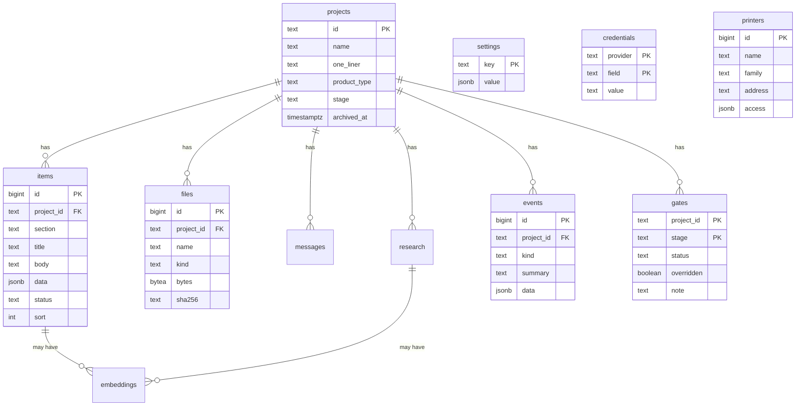

# Database design

Decided 20 November 2026. This is the design the migrations in `migrations/` implement, and the direction for the tables still to come.

## The idea

The product is a graph. A concept is made of **rows** (a brief line, a part, a wire, a decision, a step, an ad) and **relations** between them (this step waits on that one, this wire joins these two parts, this decision opens that section, this test proves that requirement). Build order, the decision tree, wiring, traceability, and "what does this change affect" are all questions about that graph, which is why NetworkX is part of the stack.

So the database has two layers:

1. **Uniform rows.** Every section of every concept stores its rows in one table, `items`, with the same columns. This is what makes every concept work the same way and makes everything reportable without knowing what a section is.
2. **Typed structure where integrity matters.** Where a mistake would corrupt the design (a wire pointing at a part that no longer exists, two parts sharing a reference, a key used twice), the database enforces the rule itself. No code path can break it.

What goes inside a row's `data` is defined once, in `src/lib/domain/schemas.ts`, and checked by the API on every write.

## Tables today

`settings`, `credentials` and `printers` belong to the install, not to a concept.

## Rules the database enforces

| Rule | How |
|---|---|
| Deleting a concept removes its rows, files, history, research, messages and gates | Foreign keys with cascade |
| A part's reference is unique within its concept | Unique index on the reference, for rows of the parts list that have one |
| A key is unique within its concept, across all sections | Unique index on the key, for rows that have one |
| A row's `data` is always an object | Check constraint |
| A title and a concept name are never blank | Check constraints |
| A gate has one of four statuses, and an override always carries a reason | Check constraints |
| One value per credential field | Primary key |
| A stored file is at most 25 MB | Check constraint |
| An embedding has the width it says it has | Check constraint |

A broken rule reaches the user as a plain sentence. The API maps each constraint to its message in `src/lib/api/route.ts`.

## Migrations

- SQL files in `migrations/`, applied in order at start-up by `node-pg-migrate` and recorded in `schema_migrations`.
- The first, `0001_baseline`, is the schema as it stood before migrations existed, written so it is safe on a database that already has those tables. An existing install adopts migrations without losing anything.
- A migration that tightens a rule first repairs existing rows that would break it, and writes what it changed to the concept's history. `0002_integrity` does this for repeated references and keys.
- Migrations are never edited once released. A change is a new file.
- pgvector is optional, so it is set up outside the migrations: with it, an `embeddings` table exists; without it, search matches text.

## Decisions and their reasons

**Keep one `items` table.** Splitting each section into its own table would give column types, but would end uniform reporting, uniform history, and "add a section by adding a line to the menu". The types are enforced one layer up instead, by the schemas.

**Credentials are stored as entered** (owner's decision D3). They are in their own table, one row per field, so that if this is revisited the change is confined to that table and the one module that reads it.

**Embeddings get their own table with no fixed vector width.** The embedding model is chosen in Admin, and models differ in width. A fixed-width column would tie the schema to one model. Each width gets its own index the first time it is used.

**History lives in `events`.** Each change records the row it is about and, from item 3.4 of the plan, the values before and after. One table to read for "what happened", for any kind of row.

**The example concept is loaded once per database**, recorded in `settings`. Deleting it does not bring it back on the next start.

## Still to come, in the order the plan needs it

| When | What | Why |
|---|---|---|
| Plan 2.3 | `users`, `sessions` | Sign-in. If Better Auth is used it creates and migrates its own tables. |
| Plan 3.5, 4.8 | `links (project_id, kind, from_item, to_item, …)` with foreign keys | Relations between rows that are not keys today: requirement to test, requirement to part, decision to the rows it opens. One table means one graph to hand to NetworkX for "what does this change affect". |
| Plan 5.1 | `part_kinds`, `pins (item_id, name, kind, position, side)` | Pins become rows, so they can have a type (for electrical checks), a position on the part (for wire routing) and a side on the symbol. |
| Plan 5.12 | Wires reference pins by id; `routes` or route data on the wire | Renaming a part can no longer break a wire, and a routed length has a place to live. A part in series becomes an ordinary two-pin part; the special "via" field goes away. |
| Plan 8.13 to 8.17 | `metrics (item_id, day, spend, clicks, orders, revenue, source)`, `sales (channel, day, units, revenue, order_ref, source)` | Campaign results and sales are time series, not rows in a list. |

When wires move to pin ids, the existing key lists (`after`, `dependsOn`, `unlocks`) move into `links` in the same migration, so there is one way to express a relation and not two.
