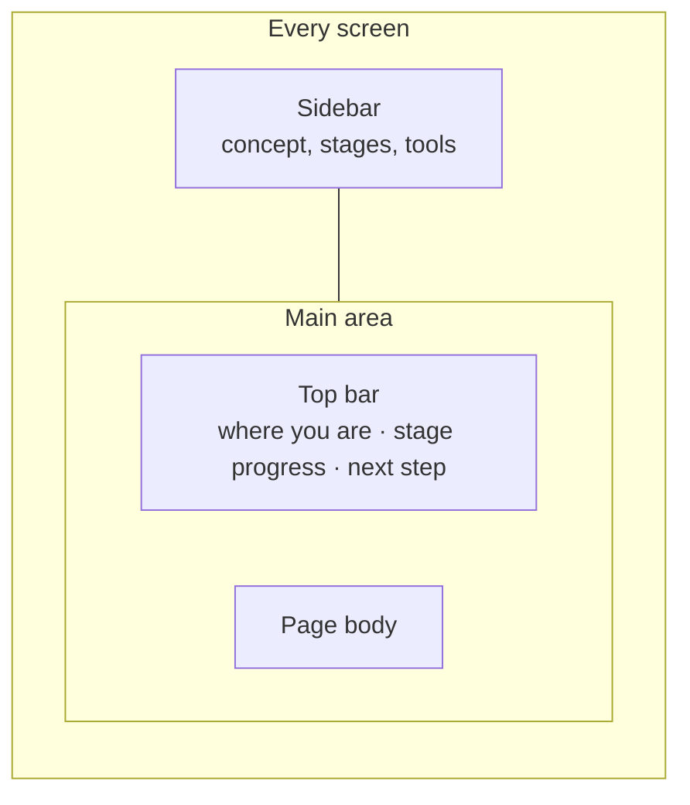

# Visual system

Decided 20 November 2026. How the interface looks and behaves, so every screen is built the same way. It replaces four separate local kits that grew in the first build.

## Foundations

| Decision | Choice |
|---|---|
| Styling | Tailwind CSS 4 (decision D12) |
| Components | shadcn/ui, with its default primitives. Components are copied into the repository, so they are ours to adjust |
| Look | The Eigenia look carried over as variables: warm paper in light, obsidian in dark, hairline borders, one accent |
| Accent | Dutch Orange `#E05A10`, the only accent in both themes. Never a large filled area |
| Type | Inter for everything; JetBrains Mono for references, figures, keys and small labels |
| Corners | 12 px by default, 16 px for large panels, fully round only for pills and dots |
| Motion | CSS only: a 150 ms hover and a short fade on entry, both switched off for people who ask for reduced motion. The animation library is removed |
| Themes | Light and dark are designed together. A screen that works in one only is not finished |
| Language | English |

Colour is never the only signal. Net classes, statuses and warnings each carry a label or a line style as well as a colour.

**Not used:** a second accent colour, gradient text, glow effects other than one focus highlight, a row of headline numbers under a page title, stock imagery, placeholder figures.

## The frame

- **Sidebar**: the concept switcher with search and a link to all concepts; the seven stages and their sections, showing only the sections this concept's product type has; then the tools (order of operations, report, documentation, admin).
- **Top bar**: the stage and section, the gate status of the stage, and one **next step** button. This is the single place the app tells you what to do next.
- **Command palette** (Ctrl or Cmd K): jump to any section, concept or row.

## Page patterns

Every screen is one of four patterns. A new screen picks one; it does not invent a fifth.

| Pattern | Used for | Layout |
|---|---|---|
| List | Brief, questions, claims, tests, most of Production, Marketing, Sales | A table with a board view where rows have a status. Row opens in a side sheet |
| Canvas with detail | Decision tree, schematic, physical layout, 3D model, order of operations | The canvas on the left, a detail panel on the right for whatever is selected, a toolbar above the canvas, checks below it |
| Document | Report, build sheet, guides, generated landing page preview | A reading column, printable |
| Form | Wizard, admin, settings | One column, grouped fields, one primary action |

The **canvas with detail** pattern is one shared component. The decision tree, schematic, layout and 3D model each supply a canvas and a detail panel; the split, the resizing, the toolbar and the keyboard handling are written once.

## States

One way to show each, everywhere:

| State | Shown as |
|---|---|
| Loading | Grey placeholder blocks in the shape of what is coming. Never a bare "Loading" |
| Empty | One sentence saying what will appear here, and the one action that makes it appear |
| Error on load | The message in place of the content, with a retry |
| Error on save | A toast with the server's sentence; the change is rolled back on screen |
| Saved | Nothing. The change simply stays |
| Not configured | A sentence saying which setting is missing and a link to it in Admin |

## Diagrams

- All node-and-edge diagrams use React Flow, with shared node chrome.
- Layout is automatic: a tree layout for the decision tree, a layered layout for the order of operations and for pins and wires. A position the user sets is kept and never overridden by the next automatic layout.
- Lines are orthogonal where they represent wires, curved where they represent order or dependence.
- Net class by colour **and** line style: power solid thick, ground dashed, signal solid thin, audio dotted.

## 3D

| Decision | Choice |
|---|---|
| Engine | three.js with React Three Fiber. Not Babylon.js: its React bindings do not yet support the React version in use, and its solid-cutting feature is a library three.js can use directly |
| One source of shape | What is drawn and what is exported for printing are the same solid. Today they are two separate pieces of code |
| Selecting | Click a part to select it: outline, detail panel, and the camera frames it. Click empty space to clear |
| Moving | Drag handles on the selected part to move and rotate, snapped to the grid, with the numbers editable in the panel |
| Views | Buttons for isometric, top, front, side, and fit all |
| Exploded view | Parts move apart in the order they are assembled, taken from the assembly steps, along the direction they are inserted. A hand-set direction overrides it |
| Section | A cutting plane the user drags, with the cut face filled |
| Wires | Drawn along their routed paths once routing exists; straight lines until then, marked as not routed |
| Printed parts | Shown in the print material's colour, with standoffs, bosses and cutouts visible |
| Keyboard | Every action available from the detail panel, so the 3D view is never the only way to do something |

## Order of work

1. Tailwind 4 and shadcn/ui, with the Eigenia variables. Every existing screen looks as it did. (Plan 1.4)
2. The frame: sidebar, top bar with next step, command palette. (Plan 1.4, 3.1)
3. The four page patterns and the six states as shared components; local kits deleted. (Plan 1.4, 1.5)
4. Diagram layouts. (Plan 1.6)
5. 3D decisions above, with the design tools. (Plan 5.2, 5.6)
