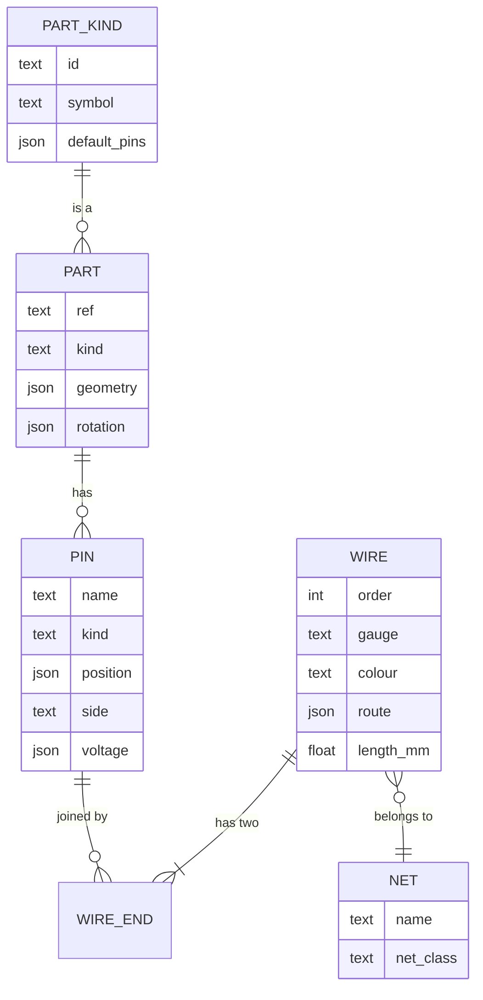

# Wiring model

Decided 20 November 2026. How the electrical side of a concept is modelled, checked, routed and drawn. It applies to concepts whose product type includes electronics.

## What exists today

Parts are rows of the parts list. A wire is a row that names two parts by reference and a pin name on each (`from`, `fromPin`, `to`, `toPin`), a net name, one of four net classes, and optionally a part in series (`via`). Pins exist only as names typed into wires. Electrical nets are worked out from the wires. Wire length is estimated from the distance between part centres.

That is enough to draw a diagram and a soldering list. It is not enough to check a circuit, route a wire or draw a proper symbol, because a pin has no type and no position, and a part has no kind.

## The model

**A part has a kind.** Resistor, capacitor, diode, LED, switch, push button, battery, speaker, connector, sensor, module, regulator, motor, generic. The kind picks the symbol and supplies default pins, so adding a resistor gives two pins without typing.

**A pin is a thing, not a name.** Each pin has:

- a kind: power in, power out, ground, input, output, bidirectional, passive, not connected. This is what makes electrical checks possible;
- an optional voltage range it accepts or supplies;
- a position on the part's body in millimetres, in the part's own coordinates, which is where a routed wire ends;
- a side on the symbol (left, right, top, bottom), defaulted from its kind: power at the top, ground at the bottom, inputs left, outputs right.

**A wire joins two pins.** It carries a gauge, a colour, its soldering order, and once routed its path and length.

**A part in series is just a part.** The `via` field goes. A series resistor is a two-pin part with a wire to each pin. This removes the special case in the net calculation and lets the resistor appear in the parts list, the symbol view and the checks like any other part. Existing wires with `via` are split in two by the migration that introduces pins.

**Nets are worked out, not typed.** Pins joined by wires are one net. A net's class comes from its pins (any ground pin makes it ground; any power pin makes it power) and can be overridden. A net's name defaults to a power or ground pin's name, else it is numbered, and can be set.

## Electrical checks

Run on every change, shown beside the schematic, each one naming the parts and pins involved.

| Check | Catches |
|---|---|
| Two outputs on one net | Outputs fighting each other |
| A power-in pin on a net with no power-out pin | A part that is never powered |
| A supply outside a pin's stated voltage range | A 3.3 V part on a 5 V rail |
| An input pin connected to nothing | A floating input |
| A net with one pin | A wire to nowhere |
| A shared bus with no pull-up where the part kind needs one | A bus that will not idle high |
| A part with pins and no wires | A part left out |
| A wire from a pin to another pin on the same part with nothing between | A short, or a mistake |

Checks say what is wrong and why it matters. They do not claim a circuit is correct; they catch the mistakes a checklist can catch.

## Routing wires through the enclosure

Decision D5: NetworkX does the routing, in the Python service.

1. **Space.** The inside of the enclosure is cut into a grid of cells. Cells inside a part's body, grown by a clearance, are removed. What is left is where a wire may run.
2. **Grid size.** 2 mm cells by default. If that would exceed about 150,000 cells the cell size grows until it does not. The size used is reported with the result. The speed of this must be measured on the example before the default is fixed.
3. **One wire.** The shortest path between its two pins through the free cells (A*). Cells already used by another wire of the same harness cost less, so wires bundle and do not each take their own way.
4. **A net with more than two pins** (ground, power) is routed as one tree joining all its pins (a Steiner tree), and the points where it branches are reported as splices.
5. **Length.** The path is straightened where it can be, measured, and a service allowance is added at each end. The allowance is a setting. The result is rounded up to the next 5 mm.
6. **When it cannot route.** A pin buried inside another part, or with no free path, is reported by name. Nothing is guessed.

A route is stored on the wire with a fingerprint of what it was computed from (part positions, pin positions, enclosure size). When any of those change, the route is shown as out of date until it is recomputed.

The routed length replaces the centre-to-centre estimate on the build sheet and the cut list, and the path is drawn in the 3D view.

## Three views, one set of data

| View | Shows | For |
|---|---|---|
| Symbols | Standard symbols, net labels, power and ground symbols, a title block | Reading and reviewing the circuit |
| Pins and wires | Every part as a box with its real pin names, every wire individually | Building it: this is what you solder |
| Blocks | One box per part, one line per group of nets between two parts | Explaining it |

A toggle switches between them. Each view keeps its own positions. A wire added in one appears in the others.

**Symbols come from the `schematic-symbols` library (MIT), drawn inside our own schematic nodes.** Each symbol is plain data: its lines and where its pins are. Our editor keeps doing the dragging, connecting, saved positions and highlighting; switching view swaps what a node draws, not the data. The library's own layout engine, renderer and viewer are not used: in a trial on the example circuit its layout placed labels where they suggested wrong connections, rotated every symbol when one position was supplied, and rerouted unrelated wires when one wire was added. The trial and its evidence are in `docs/trials/tscircuit`. Before a symbol is copied in, its origin is checked in the library's history; where that cannot be shown, the shape from schemdraw (MIT) is used. Symbols from KiCad's library are not bundled, because redistributing them carries that library's share-alike licence.

## Outputs

- A KiCad schematic file, checked by loading it with KiCad's own command-line tool.
- A wiring table and a harness drawing (through WireViz, run as a separate process).
- The soldering build sheet, with routed lengths, gauge, strip length and the order to work in.

## Order of work

1. Part kinds and pins as rows, with the migration that splits `via` wires. (Plan 5.1)
2. Electrical checks. (Plan 5.4)
3. Symbol view and the toggle. (Plan 5.3)
4. Pin positions, part rotation, then routing. (Plan 5.2, 5.12)
5. Exports. (Plan 5.5, 5.13)
