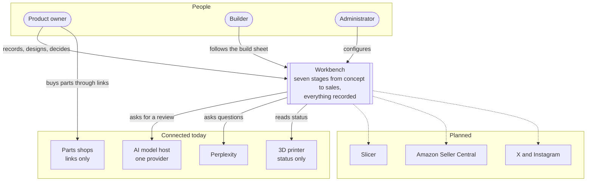

# System context

The workbench, the people who use it, and the outside systems it touches. This is the top level of the C4 model: people and systems, not technologies.

## Overview

**In one sentence:** a self-hosted workbench that takes a product concept from idea to sales through one uniform set of stages.

**In more detail:** a person records a concept, has it challenged, researches it, designs it (parts, wiring, layout, 3D model), builds a prototype (sourcing, printing, soldering, assembly, tests), and then plans production, marketing and sales. Everything is stored in one database and can be reported. It runs on the owner's own machine in Docker.

## People

| Person | Who they are | What they want | What they use |
|---|---|---|---|
| Product owner | The person with the concept. Today the only user. | To get from an idea to a product on sale, with each step recorded. | Every stage, the order of operations, the report. |
| Builder | Whoever assembles the prototype; may be the same person. | To know what to buy, print, solder and assemble, in what order. | Sourcing, 3D printing, the build sheet, assembly, tests. |
| Administrator | Whoever installs and maintains it; may be the same person. | A running install, working connections, backups. | Settings, Integrations. The Admin area is planned. |
| Developer | Whoever changes the code. | To add sections, fields and integrations safely. | The code, the tests, these pages. |

## Outside systems

| System | What it provides | Status |
|---|---|---|
| AI model host | Pushes back on the concept and embeds rows for search by meaning. Planned: drafts each stage from the one before. | Built for Ollama, LM Studio and OpenRouter, chosen in Admin; tested against a stand-in, not yet against a real host. |
| Perplexity | Answers research questions with sources. | Connected, not yet exercised. |
| 3D printer | Prints the enclosure. | Status only, for OctoPrint and Moonraker. Sending a print is planned for seven printer families. |
| Slicer (OrcaSlicer) | Turns a 3D file into printer instructions. | Planned. |
| Amazon and Micro Center shops | Where parts are bought. | Search and cart links only. The app does not order. |
| Amazon Seller Central | Sales figures and the product listing. | Planned. |
| X and Instagram | Posts and replies. | Planned. Drafts are kept in the app today. |

## Diagram

Solid lines work today. Dotted lines are planned.

## Journeys

**Product owner, new concept**

1. Starts the wizard and gives the concept a name.
2. Fills in the brief and asks the reviewer to challenge it.
3. Lays out the decisions and makes the first ones.
4. Enters parts, places them, and wires them.
5. Reads the order of operations and the report.

**Builder, first prototype**

1. Opens Sourcing and buys the parts through the links.
2. Generates the enclosure file and prints it.
3. Works down the build sheet, ticking each wire.
4. Follows the assembly steps and records the test results.

**Administrator, install**

1. Copies the settings file and starts the containers.
2. Opens Integrations to see what is connected.
3. Adds keys for the services wanted and restarts.

## Related pages

The developer guide covers the containers and the code layout.
