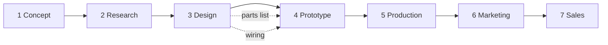

# User guide

This guide describes what the workbench does today. Where something is not built yet, it says so.

## What this is

A workbench that takes a product concept through seven stages, from the first idea to sales. Every concept uses the same stages and the same structure, so anything you learn on one concept applies to the next. The example concept that ships with it is **Baggage Claims MK1**.

The dotted lines are the links that work today: the parts list and the wiring you enter in Design drive the Prototype screens. The other stages do not feed each other yet.

## Getting around

- **Concept switcher** (top of the sidebar): choose which concept you are working on. **New concept** starts the wizard. **All concepts** opens the Concepts page.
- **Stages and sections** (sidebar): the seven stages, each with its sections.
- **Order of operations**: the build order worked out from your steps.
- **Report**: everything recorded for the concept on one printable page.
- **Integrations**: what is and is not connected to outside services, each with a link to where it is set.
- **Admin**: keys, models, printers and the audit log. Features that need a model, key or printer say so and link to the right tab.
- **Dark theme**: bottom of the sidebar.

## Concepts

The Concepts page lists every concept with its name, one line, product type, stage, when it last changed and how many rows it has. Search covers names and descriptions. Sort by last changed or by name.

- **Open** makes a concept the current one and takes you to its overview.
- The menu on each row has Edit, Duplicate, Export as JSON, Archive (or Restore) and Delete.
- **Edit** changes the name, the one line, the product type and the stage. Changing the product type tells you which sections will be hidden. Their rows are kept, not deleted; change the type back to see them again.
- **Duplicate** copies every row and file into a new concept. Activity history, reviewer messages, research answers and stage decisions stay with the original.
- **Archive** takes a concept out of the sidebar. It stays under Archived on this page, where you can export, restore or delete it. Nothing is deleted.
- **Delete** lists what will go and offers a JSON download first. It needs the concept's exact name typed. The deletion is recorded in the audit log, which is kept. If the deleted concept was open, the app opens another. If it was Admin's default concept, that setting is cleared.
- **Linking to a concept:** add `?concept=<id>` to any address, for example `/report?concept=baggage-claims`, to open that concept there.

## Starting a concept

**New concept** opens a six-step wizard: name and one-line description, who it is for and why, how it works, whether any part is 3D printed and its outer size, the parts you already know, the cheapest test, and the sales channel, price and candidate names. Only the name is required. The wizard saves exactly what you typed and turns blanks into open questions.

After the wizard you land on the overview. The app does not yet tell you what to do next; work down the sidebar from Concept.

## The stages

### 1 Concept

| Section | What you do there |
|---|---|
| Brief | Record what the product is, who it is for, why now. |
| Challenge | Ask the AI reviewer to push back on the proposition. Needs an AI key; without one the box is disabled. |
| Names and taglines | Collect candidates and move them between candidate, shortlist, chosen and rejected. |
| Decision tree | Lay out the decisions the concept depends on. Click a decision to see its options, outcomes and what it depends on, and choose an option. A decision cannot be chosen until the decisions it depends on are made. |
| Open questions | Keep the list of things you do not know yet. |

### 2 Research

| Section | What you do there |
|---|---|
| Ask | Put a question to Perplexity and keep the answer with its sources. Needs a Perplexity key. Each question is billed to your Perplexity account; Perplexity's own estimate of the cost is shown after the answer. |
| Claims to verify | The claims the concept rests on, each unverified, verified or wrong. |

**Checking a claim.** Open a saved answer in Ask, choose **Use as evidence** beside one of its sources, pick the claim, and say whether that source supports it, contradicts it, or is unclear. You can add a quote.

- A claim becomes **verified** when at least one source supports it and none contradicts it.
- It becomes **wrong** when a source contradicts it and none supports it.
- Otherwise it stays **unverified**. When sources disagree it is shown as *Disputed: sources disagree*.

The verdict on each source is yours; the app records it and works the status out from it. The Claims to verify board shows each claim's evidence on its card and in its editor: every source's title, what it says about the claim, the quote, and the day it was judged, with the status and its reason in words, for example "Verified: 1 source supports it, none contradicts". Remove a source there or in Ask. You can still set a status by hand, but only to one the evidence allows: verified needs at least one supporting source and none contradicting; wrong is refused while sources support the claim and none contradicts it; unverified is always allowed. A new claim cannot start as verified. The next change to a claim's evidence sets its status from the evidence again. Saved answers keep each source's title, so they read the same after a reload; answers saved before this change show the address instead.

Nothing here has been run against the real Perplexity service yet. It is built to Perplexity's published documentation and tested against a stand-in.

### 3 Design

| Section | What you do there |
|---|---|
| Requirements | What the product must do. |
| Bill of materials | The parts list: reference, quantity, source, search term, cost. Import and export CSV. The total is worked out for you. |
| Physical layout | Place each part inside the enclosure in top, front and side views. Drag to move, arrow keys to nudge. The app warns about parts that overlap, sit outside the enclosure or float. |
| 3D model | The same parts in 3D. Slide to explode the assembly, click a part to focus on it, and switch on the wire overlay. |
| Schematic | Parts, pins and the wires between them. Drag from pin to pin to add a wire. Exports a wiring table, a netlist and a drawing. |

Parts are drawn as boxes and cylinders from the sizes you enter. Schematic parts are drawn as boxes with pins, not as standard symbols. Parts cannot be rotated yet.

### 4 Prototype

| Section | What you do there |
|---|---|
| Sourcing | Search links for each part at Amazon and Micro Center, and one cart link for parts that have an Amazon item number. The app does not buy anything. |
| 3D printing | Generate a print file for the enclosure (a plain tray and lid) and keep a list of print jobs. Printer status can be shown; the app cannot start a print yet. |
| Wiring and soldering | A build sheet made from the schematic: the order to solder in, which pins each wire joins, a cut list, and a tick box per wire. |
| Assembly | The assembly steps. Give a step a key, what it waits on and how long it takes, and it joins the order of operations. |
| Acceptance tests | The tests the prototype must pass, each marked not run, pass or fail. |

Wire lengths on the cut list are estimates from the distance between parts, not routed lengths.

### 5 Production

| Section | What you do there |
|---|---|
| Unit economics | Record cost, price and margin at each volume. You type the figures; the app does not work them out from the parts list. |
| Batch plan | Plan each batch: units and the gate that must be passed to start it. |

### 6 Marketing

| Section | What you do there |
|---|---|
| Positioning | Record how the product is positioned. |
| Landing pages | List the pages you plan, with the path and the call to action. |
| Ads | Keep ad copy by channel, with its rule for stopping or scaling, and move each from draft to approved, running or killed. |
| Campaigns | Plan campaigns by funnel stage, budget and measure of success. |
| Social | Draft posts, approve them, copy them out, and mark them posted. |

### 7 Sales

| Section | What you do there |
|---|---|
| Amazon listing | Keep the listing text field by field. |
| Sales monitor | Log sales by hand and see totals by channel. |
| Channels and pricing | Record each channel's price, the platform's take and what is left. |

> **Going to market is not built yet.** Stages 5 to 7 are lists you fill in by hand. Nothing is generated: no positioning, brand, tagline, ad or landing page is drafted for you, no landing page is rendered, nothing is posted, and no sales arrive from Amazon. The plan covers this in its go-to-market phase.

## Order of operations and report

**Order of operations.** Every row with a key takes part. A row in the Decision tree is a decision; every other keyed row is a step.

- A step waits on the keys in its "waits on" list.
- A decision waits on the decisions it depends on, and comes before every step in each section it unlocks. A decision takes no time; it is a milestone, and it counts as made once an option is chosen.
- A finished step counts as zero. The total is the work left along the longest chain (the critical path); the planned figure beside it is the full time of that same chain.
- If rows wait on each other in a loop, no order exists for them. They, and everything that waits on them, are marked blocked until the loop is broken.
- A link to a key that does not exist is ignored and listed.

The order is worked out by the planner service. If that service is not running, the page lists the steps and decisions without an order and says so. It never guesses one.

The page does not yet draw decisions differently from steps, or the lines from a decision to the steps it unlocks.

**Report** gathers the whole concept, with its history, for printing or download.

## What is saved, and where

Everything is saved as you go in the database that runs alongside the app. Files such as print files are stored there too, up to 25 MB each. There is no undo; the activity history in the report shows what changed and when.
