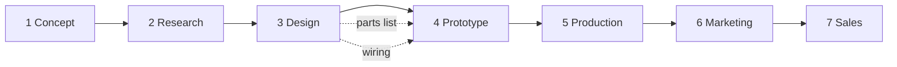

# User guide

This guide describes what the workbench does today. Where something is not built yet, it says so.

## What this is

A workbench that takes a product concept through seven stages, from the first idea to sales. Every concept uses the same stages and the same structure, so anything you learn on one concept applies to the next. The example concept that ships with it is **Baggage Claims MK1**.

The dotted lines are the links that work today: the parts list and the wiring you enter in Design drive the Prototype screens. The other stages do not feed each other yet.

## Getting around

- **Concept switcher** (top of the sidebar): choose which concept you are working on. **New concept** starts the wizard. **All concepts** opens the Concepts page.
- **Stages and sections** (sidebar): the seven stages, each with its sections.
- **Order of operations**: the build order worked out from your steps.
- **Report**: everything recorded for the concept on one printable page.
- **Integrations**: what is and is not connected to outside services, each with a link to where it is set.
- **Admin**: keys, models, printers and the audit log. Features that need a model, key or printer say so and link to the right tab.
- **Dark theme**: bottom of the sidebar.

## Concepts

The Concepts page lists every concept with its name, one line, product type, stage, when it last changed and how many rows it has. Search covers names and descriptions. Sort by last changed or by name.

- **Open** makes a concept the current one and takes you to its overview.
- The menu on each row has Edit, Duplicate, Export as JSON, Archive (or Restore) and Delete.
- **Edit** changes the name, the one line, the product type and the stage. Changing the product type tells you which sections will be hidden. Their rows are kept, not deleted; change the type back to see them again.
- **Duplicate** copies every row and file into a new concept. Activity history, reviewer messages, research answers and stage decisions stay with the original.
- **Archive** takes a concept out of the sidebar. It stays under Archived on this page, where you can export, restore or delete it. Nothing is deleted.
- **Delete** lists what will go and offers a JSON download first. It needs the concept's exact name typed. The deletion is recorded in the audit log, which is kept. If the deleted concept was open, the app opens another. If it was Admin's default concept, that setting is cleared.
- **Linking to a concept:** add `?concept=<id>` to any address, for example `/report?concept=baggage-claims`, to open that concept there.

## Chat

Chat (in the sidebar) answers questions about the open concept using only what is recorded for it: its rows and its saved research answers. Each answer cites its sources as small numbers. Point at one to see what it is, and select it to open the section that holds it; the full numbered list is under the answer. If nothing recorded covers your question, the answer says so. Under each answer you can see which model answered and how the sources were found: by meaning, by matching words, or both joined. Matching words folds word forms, so "wires" finds "wire", and a question that names a section, such as "What is still open in Bill of materials?", brings in that section's rows. Chats are kept per concept. Start a new one with New chat, and delete one with the bin beside it.

Chat needs a reasoning model chosen in Admin, Models. If the screen says search by meaning is not set up, choose an embedding model in Admin and then "Index this concept". Until then chat still works, but finds sources by matching the words of your question. Index again after adding many rows or research answers.

Not verified: chat has been run against a stand-in model only, so nothing here says how good a real model's answers are.

## History, activity and traceability

- **History.** In a row's editor, History lists that row's changes newest first, with who and when. Each field shows before and after; "Restore this value" puts one old value back as a new, recorded change.
- **Activity** (in the sidebar) lists every change in the concept, filtered by section and kind.
- **Traceability.** In a requirement's editor, pick the tests that check it and the parts it needs; a pick saves at once. Requirements then show "2 tests, 1 part" or "No test covers this". The Traceability page shows the requirement-by-test matrix with each test's status, and three lists of gaps: requirements with no test, tests that check no requirement, and parts no requirement needs. Deleting a test or part asks first and removes it from every requirement and build that named it.

## Drafting with AI, challenge and impact

Sections a generator can fill have a **Draft with AI** button. It says what it will read; when you run it, the rows it proposes wait for review as drafts, each with the rows it came from. Edit, approve or reject each one, or approve a whole run. A draft never counts as a row until you approve it. Running again asks before marking older waiting drafts superseded. Generators read approved rows only.

An approved press release or FAQ entry is attacked once by the reviewer; **Revise with this critique** makes a new draft. In any row's editor, **Challenge this** asks the reviewer to argue against the row (saved in Challenge with a link back), and **Verify this** opens Research with the row as the question.

After you change a decision, a requirement or a part, a notice says how many rows it affects. **Show what it affects** lists them by section with the reason, and **Propose updates** drafts changes to them, each shown before and after. Unit economics and the decision tree are listed as "Review by hand".

**Drafts** in the sidebar lists every draft of the concept. **Optimise** offers lower parts cost, fewer parts and shorter print time, measured from your rows: cost only when every part is priced, print time only from times entered after slicing.

## Editing the 3D model and routing wires

In **3D model**, select a part, pick Move or Rotate and drag (steps of 1 mm and 15 degrees) or type the numbers. Arrow keys nudge, R turns, Ctrl+Z undoes and Ctrl+Shift+Z redoes. **Section cut** hides one side along each axis. **Measure**: click two points. Under **Real shape**, attach an STL or STEP file for a part; a file that looks like metres or inches is flagged and you choose the unit, it is never rescaled for you. Export the assembly or one part as STL, and the enclosure and printed parts as 3MF.

**Route wires** needs the planner. Each wire is routed around the parts and its length is saved; the build sheet then shows "routed" lengths. Moving a part marks those lengths out of date until you route again. A wire end with no pin position starts at the middle of the part's face, and the page says how many do. **Draw the harness** on the Wiring page draws the harness diagram with WireViz.

## Parts, pins and the schematic

In the bill of materials, open **Kind and pins** on a part. Choose its kind and, if one matches, a library entry. An entry gives real pin names and, where a datasheet states them, voltages and currents, each with a link to its source; where makers differ, no figure is given. **Change these pins** edits a part's own pins: kind, symbol side, voltage range or voltage given, most current, bus line, optional, pulled up. Kind and pins show only for product types that have a schematic.

On the schematic, switch between **Symbols** and **Pins and wires**; selecting a wire or a pin lights it in both. **Electrical checks** lists findings worst first; press one to select its rows. A part with no library entry gets fewer checks and the panel says so. **Print or PDF** prints the sheet with its title block; the revision is the concept's newest named build. The KiCad schematic downloads from Wiring files.

## Enclosure

**Design, Enclosure** builds a printable base and lid around your parts. It needs at least one part with a size and place in Physical layout, and says so when there is none. Pick a generator: CaseMaker runs inside the workbench in a few seconds; YAPP_Box runs in OpenSCAD in the planner service and takes about a minute, and shows as not available, with the reason, when the planner is not running. Set the parameters (the defaults are under each field; problems show as you type) and press Generate, or Generate with both to compare side by side. Under the 3D preview are five checks worked out on the generated model, each marked met or not met with its numbers: base watertight, lid watertight, lid closes, every part fits with the stated clearance, every opening lines up with its part. Download the base STL, the lid STL (print side down) and the generator's own source file.

## Printers

Printers are added in Admin, Printers by choosing the model from the supported list, which is also at `/printers` with the source for every fact. **Prototype, 3D printing** shows each printer's state, file, progress, time left and temperatures. Pause and Resume act directly; Stop asks first and names the printer and the file. Test checks the connection. A printer marked Experimental is built from documentation that does not name your model: run Test before relying on it. A file-only printer gets the file and the steps to carry it over.

## Slicing and printing

On **Prototype, 3D printing** choose New print job: pick a stored STL or 3MF (the enclosure is listed first), a printer from Admin, material, layer height and infill. **Slice** sends it to OrcaSlicer; the print time and material shown come from OrcaSlicer's own output, never an estimate of ours. If the printer has a connection, **Send** puts the file on it and **Start** begins the print; both open a dialog that names the printer and the file, and nothing moves until you press the button in that dialog. If the printer has no connection, download the file and follow the steps, then press Record result. Record how it came out (good, flawed or failed, the real time and grams, photos, notes); the planned numbers stay beside the actual ones.

## Sourcing

Open a part to see search links for Digi-Key, Mouser, LCSC, Adafruit, SparkFun, Amazon, AliExpress and McMaster-Carr. Search yourself and add offers by hand: price of one pack, pack size, stock, lead time, link, date checked. **Check prices** and **Find alternates** ask Perplexity (billed, so it asks first) and save drafts with the page each came from; a line with no cited page is dropped, and a draft counts as nothing until you accept it. The chosen offer sets the part's unit price. The shopping list groups what is left to order by supplier in whole packs with totals, and downloads as CSV. The app never places an order.

## Build sheet wire details

Wire length uses the routed length plus the service allowance when the 3D model has routed the wire, otherwise an estimate, and says which. Wire gauge is chosen from the current the part draws using a named table; with no current set it says "not set" and does not guess. Strip lengths are starting values from general bench practice, not from a data sheet: change them to match your connector's data sheet.

## Marketing content

Every piece of marketing content is tied to one approved Positioning message and follows the brand kit's voice. Any line with a number or a superlative (best, only, 100%) needs a linked proof row (a verified claim, a passing test, a requirement or an approved price whose text holds the number); without one it is flagged **No proof** and cannot be approved. Nothing is posted, sent or published by the app.

- **Ads:** choose a channel (Amazon Sponsored Products and Sponsored Brands, Meta feed, Instagram feed, Stories, X, Google responsive search, TikTok, Reddit, Pinterest). Each shows what it accepts and where each limit comes from. A limit taken from the platform's own page cannot be exceeded; limits the platform's page could not be read for only warn and say "Not verified". Write the stop and scale rule and set two numbers yourself: the highest cost per order you accept and the least you will spend before judging. Export CSV per channel after approving.
- **Landing page:** sections you edit in place and reorder; Preview shows the page in your brand kit; `/p/<concept id>` opens it only while signed in, marked "Public preview, not published". Images need alt text. The comparison shows only competitors that have a source. Approve every section, then Export zip (index.html plus images).
- **Amazon listing** (Sales): title, five bullets, description and search terms per category; Amazon's claim rules show as warnings with a source link; tick the image checklist from Imagery; export text or a flat-file row once the listing is ready.
- **Social:** Board or Calendar; give a post a date or drag it; an approved post with a date becomes scheduled.
- **Launch email and press note:** from the approved press release: subject options, preview text and body, a press note and a three-email sequence outline; export HTML or text.

## Campaigns, launch plan, results and tracked links

- **Campaigns:** set the marketing budget and the share of the margin an order may cost in "Marketing budget and rules", then add campaigns or use **Draft a campaign plan**. Allowable cost per order is the margin per unit before ads times your share; the screen shows the sum. Targets and stop and scale rules are numbers you enter. The board shows campaigns by status, the calendar by date, and the monthly roll-up against your budget.
- **Launch plan:** pick a template (Kickstarter, Amazon, own site, retail, soft launch) and a launch date; every step gets a due date counted back from it. Change the date and every step moves. A step that needs a gate or a build says so. Steps marked "Check" rest on platform rules with no source: read the platform's own help page first. No step posts or buys anything.
- **Campaign results:** enter a day, paste a report, or open a CSV from Amazon Ads, Meta or Google Ads. Check the column match; it is remembered per channel. The column names offered for those platforms have not been checked against real export files, so look before you import. The verdict (stop, hold, scale, not enough data) comes from your rule, not from a model. **Explain this with the model** adds a labelled note only and is never saved as a result.
- **Tracked links:** make a UTM link per campaign or creative; the short `/l/` address counts clicks per day and records nothing about the visitor. QR codes work only from the app's public address.

## Posting, replies, reviews and Amazon sales

None of this has run against a real Amazon, X or Instagram account; each screen says so. Nothing is posted by itself: a scheduled date is only a reminder.

- **Posting** (Marketing): approved and scheduled X and Instagram posts from Social. Each is sent only when you press its button and confirm the exact text, the account and, for X, the cost. Before the first send you tick that you have read X's dated cost statement. Instagram needs the public address of a JPEG copy of the image, because Meta fetches the image itself and this app sits behind sign-in.
- **Replies and comments** (Marketing): Read X mentions and Read Instagram comments act only when you press them. Draft with AI drafts replies in the brand voice.
- **Replies to send** (Marketing): approved replies. X and Instagram replies have Send, with the same confirmation. Replies to reviews have Copy and Mark as posted by hand, because the app never posts them.
- **Reviews and questions** (Sales): add, paste or import a CSV (a text, review, body or question column is needed). Set topic and sentiment, or have them suggested as drafts. "What customers keep asking" groups the rows; "Turn into a requirement" makes a draft requirement that cites them.
- **Sales monitor:** pick the marketplace and press Sync now; there is no automatic sync. Amazon's own daily totals sit beside the order rows for comparison and are never counted twice. Only order id, date, items, marketplace, currency and status are kept; no buyer or address details are requested.

## How the parts fit together

- **One unit cost and one currency.** Pricing, campaign margins, ads, the landing page price and the report all use the unit cost and the currency from Unit economics; set the currency there. A part with no price is named and left out of the total, never counted as zero.
- **Gates read real checks.** Besides rows and decisions, gates now use the electrical checks, the enclosure's five checks on the saved choice, production readiness, and proof on released content. Gates still only warn; an override needs a typed reason and can be withdrawn on the Process page. The stage changes only on the Process page.
- **One place for AI drafts.** Market pieces, the compliance checklist and sourcing's price and alternate research now wait for review in Draft with AI at the top of their page, like every other draft. Unit economics cost lines and the decision tree have no generator: review them by hand.
- **Press releases and FAQ entries** are attacked once by the reviewer on the server right after approval, whether or not you stay on the page.
- **Wire ends** use real pin positions from the part's pins or its library entry when they exist; the 3D page says how many wire ends are still approximate.
- **Send to printing** on the Enclosure page stores the base and lid, upright for a printer, as files of the concept and they appear in 3D printing. A build lists the print jobs that name it.
- **An ad run by a campaign** follows that campaign's stop and scale rule.
- **Duplicate** carries currency, regions, product type, pins, campaigns and print jobs (as queued, without results); tracked links get new codes with no clicks. Drafts, results, history and credentials are not copied.
- **The report and the overview** end with "Worked out from the rows": economics, compliance, builds, the enclosure and its checks, electrical checks, launch dates and campaign verdicts, as tables and sentences.

## The next step, boards and forms

The next step under every title leads through each stage in order: in Prototype from parts in hand to a passed build, and in Marketing from personas through positioning, price, brand kit, ads, landing page, listing, social and launch email to budget, campaigns, launch plan, tracked links and results. It names the row and what stops it, and opens the control that fixes it. **Verify this** attaches the research answer to the row; a claim is verified only by a source you judge.

Boards move cards by keyboard too: focus a card, press Space, move with the arrow keys (Left and Right change column), Space again to drop. If the server refuses a move the card returns and the reason is shown. The New concept wizard asks what kind of product you are making. A chat answer that could not finish is marked, with an Ask again button that does not save your question twice, and saved answers show how their sources were found. On the Optimise page, approving a cheaper substitute removes that part's price until you enter the new one; the button says so and the old price stays visible as "was".

## Starting a concept

**New concept** opens a six-step wizard: name and one-line description, who it is for and why, how it works, whether any part is 3D printed and its outer size, the parts you already know, the cheapest test, and the sales channel, price and candidate names. Only the name is required. The wizard saves exactly what you typed and turns blanks into open questions.

After the wizard you land on the overview. The app does not yet tell you what to do next; work down the sidebar from Concept.

## The stages

### 1 Concept

| Section | What you do there |
|---|---|
| Brief | Record what the product is, who it is for, why now. |
| Press release | The announcement you would publish on launch day, written before anything is built. Draft it with AI from the brief; once approved the reviewer attacks it once, and you can revise with the critique. |
| FAQ | The questions buyers and sceptics will ask, with straight answers. Draft with AI from the brief and press release; approved entries are attacked by the reviewer like the press release. |
| Challenge | Ask the AI reviewer to push back on the proposition. Needs an AI key; without one the box is disabled. |
| Names and taglines | Collect candidates and move them between candidate, shortlist, chosen and rejected. |
| Decision tree | Lay out the decisions the concept depends on. Click a decision to see its options, outcomes and what it depends on, and choose an option. A decision cannot be chosen until the decisions it depends on are made. |
| Open questions | Keep the list of things you do not know yet. |

### 2 Research

| Section | What you do there |
|---|---|
| Ask | Put a question to Perplexity and keep the answer with its sources. Needs a Perplexity key. Each question is billed to your Perplexity account; Perplexity's own estimate of the cost is shown after the answer. |
| Claims to verify | The claims the concept rests on, each unverified, verified or wrong. |

**Checking a claim.** Open a saved answer in Ask, choose **Use as evidence** beside one of its sources, pick the claim, and say whether that source supports it, contradicts it, or is unclear. You can add a quote.

- A claim becomes **verified** when at least one source supports it and none contradicts it.
- It becomes **wrong** when a source contradicts it and none supports it.
- Otherwise it stays **unverified**. When sources disagree it is shown as *Disputed: sources disagree*.

The verdict on each source is yours; the app records it and works the status out from it. The Claims to verify board shows each claim's evidence on its card and in its editor: every source's title, what it says about the claim, the quote, and the day it was judged, with the status and its reason in words, for example "Verified: 1 source supports it, none contradicts". Remove a source there or in Ask. You can still set a status by hand, but only to one the evidence allows: verified needs at least one supporting source and none contradicting; wrong is refused while sources support the claim and none contradicts it; unverified is always allowed. A new claim cannot start as verified. The next change to a claim's evidence sets its status from the evidence again. Saved answers keep each source's title, so they read the same after a reload; answers saved before this change show the address instead.

Nothing here has been run against the real Perplexity service yet. It is built to Perplexity's published documentation and tested against a stand-in.

### 3 Design

| Section | What you do there |
|---|---|
| Requirements | What the product must do. |
| Bill of materials | The parts list: reference, quantity, source, search term, cost. Import and export CSV. The total is worked out for you. |
| Physical layout | Place each part inside the enclosure in top, front and side views. Drag to move, arrow keys to nudge. The app warns about parts that overlap, sit outside the enclosure or float. |
| 3D model | The same parts in 3D. Slide to explode the assembly, click a part to focus on it, and switch on the wire overlay. |
| Schematic | Parts, pins and the wires between them. Drag from pin to pin to add a wire. Exports a wiring table, a netlist and a drawing. |

Parts are drawn as boxes and cylinders from the sizes you enter. Schematic parts are drawn as boxes with pins, not as standard symbols. Parts cannot be rotated yet.

### 4 Prototype

| Section | What you do there |
|---|---|
| Sourcing | Search links for each part at Amazon and Micro Center, and one cart link for parts that have an Amazon item number. The app does not buy anything. |
| 3D printing | Generate a print file for the enclosure (a plain tray and lid) and keep a list of print jobs. Printer status can be shown; the app cannot start a print yet. |
| Wiring and soldering | A build sheet made from the schematic: the order to solder in, which pins each wire joins, a cut list, and a tick box per wire. |
| Assembly | The assembly steps. Give a step a key, what it waits on and how long it takes, and it joins the order of operations. |
| Acceptance tests | The tests the prototype must pass, each marked not run, pass or fail. |
| Builds | Named builds (works-like, looks-like, EVT, DVT, PVT), each with exit criteria, the tests it must pass and dates. "Mark passed" is refused while a criterion is unmet or a linked test has not passed, and says why. |

Wire lengths on the cut list are estimates from the distance between parts, not routed lengths.

### 5 Production

| Section | What you do there |
|---|---|
| Unit economics | Add cost lines (packaging, labour, print material, print time, shipping in, scrap, tooling, certification, setup). The unit cost, the margin per channel, break-even and the chart of unit cost against batch size are worked out from the parts and these lines. A part with no price is listed as not priced, never counted as zero. "How this is worked out" shows the arithmetic. |
| Batch plan | Plan each batch: size, date and the build it belongs to. Each shows its worked-out unit cost, the cash it needs and what is not priced. The readiness panel lists four checks: tests, compliance, parts priced and sourced, economics complete. |
| Suppliers | Who supplies what: lead time, minimum order, location and a public website address. No personal contact details. |
| Part prices | A unit price, quantity price breaks and a supplier for each part. |
| Manufacturing methods | How each custom part or assembly step is made, with its tooling cost and extra cost per unit. |
| Compliance | A checklist of what may apply to this product in the regions you choose. The reasoning model can draft it from the brief and parts; you confirm row by row. This list is a prompt for your own checking. It is not legal or regulatory advice. |

### 6 Marketing

| Section | What you do there |
|---|---|
| Personas | Who buys this: the job they are trying to get done, what triggers the purchase, the objection, and where they look. Drafted from the brief, verified claims and saved research; you edit and approve. |
| Competitors | A sortable comparison of competitors and alternatives, including "do nothing". Prices and claims come from a cited research answer or from you; a row with no source is marked "unsourced: check this". Research competitors asks first and says Perplexity bills per question. |
| Positioning | One positioning line and three supporting messages, each with its proof; a message with no proof is flagged. The reviewer must attack it once before it can be approved. |
| Pricing | Candidate prices against the unit cost, channel fees and competitor prices, with margin worked out per channel. Margins marked with a star rest on an incomplete cost. |
| Names | Name and tagline candidates with reasons, each with links you follow and tick yourself: domain, marketplaces, trademark search pages, social handles. The app does not run the searches and never says a name is available. This is not a trademark or domain clearance. |
| Brand kit | Voice rules with do and do-not examples, colours with their contrast against white and black, type, logo files, tagline and boilerplate. A tool checks a piece of text against the voice. |
| Imagery | The shots a listing and ads need, each with its purpose, where it is used and the file. Hero and detail shots can be rendered from the 3D model. |
| Landing pages | List the pages you plan, with the path and the call to action. |
| Ads | Keep ad copy by channel, with its rule for stopping or scaling, and move each from draft to approved, running or killed. |
| Campaigns | Plan campaigns by funnel stage, budget and measure of success. |
| Social | Draft posts, approve them, copy them out, and mark them posted. |

### 7 Sales

| Section | What you do there |
|---|---|
| Amazon listing | Keep the listing text field by field. |
| Sales monitor | Log sales by hand and see totals by channel. |
| Channels and pricing | Record each channel's price, the platform's take and what is left. |

> **Going to market.** Positioning, the brand kit, ads, the listing, the landing page, launch pieces, social posts, campaign plans and replies can be drafted for you; each is a draft until you approve it. The landing page is drawn as a preview behind sign-in and exported as a zip for you to host. An approved post goes to X or Instagram from Marketing, Posting, one at a time after you confirm what goes where. Amazon orders are read into the Sales monitor when you press Sync now. Nothing is published, sent or bought without your confirmation in the app.

## Order of operations and report

**Order of operations.** Every row with a key takes part. A row in the Decision tree is a decision; every other keyed row is a step.

- A step waits on the keys in its "waits on" list.
- A decision waits on the decisions it depends on, and comes before every step in each section it unlocks. A decision takes no time; it is a milestone, and it counts as made once an option is chosen.
- A finished step counts as zero. The total is the work left along the longest chain (the critical path); the planned figure beside it is the full time of that same chain.
- If rows wait on each other in a loop, no order exists for them. They, and everything that waits on them, are marked blocked until the loop is broken.
- A link to a key that does not exist is ignored and listed.

The order is worked out by the planner service. If that service is not running, the page lists the steps and decisions without an order and says so. It never guesses one.

The page does not yet draw decisions differently from steps, or the lines from a decision to the steps it unlocks.

**Report** gathers the whole concept, with its history, for printing or download.

## What is saved, and where

Everything is saved as you go in the database that runs alongside the app. Files such as print files are stored there too, up to 25 MB each. There is no undo; the activity history in the report shows what changed and when.
