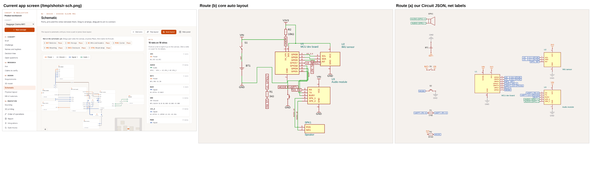
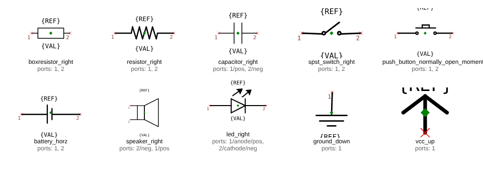

# Trial: tscircuit for the schematic symbol view

Run 20 November 2026 on the real example circuit (9 wired parts, 18 wires), outside the product. This is the record of what was tried, what was seen, and the decision.

## Decision

**Use the symbol drawings from the `schematic-symbols` package inside our own schematic nodes. Do not use tscircuit's layout engine, its renderer or its viewer.**

Before any symbol is copied into the product, the history of that symbol's file in the library's repository is checked for where the drawing came from (see "Not established" below). If that cannot be shown for a symbol, the equivalent shape from schemdraw (MIT) is used for it.

## What was tried

| Route | Result |
|---|---|
| Build the circuit in code and let the library lay it out and route it | Works. Real symbols, power and ground symbols. But labels collide in ways that suggest wrong connections; supplying one part's position rotates every other symbol; adding one wire reroutes unrelated wires. |
| Write the library's data format ourselves and render it | Works, in 2 to 4 ms. But the renderer does not route wires, so every connection is a text label; it reads like a netlist on a page. |
| The library's React viewer | Crashes under React 19 as installed (two copies of React); works once forced to one copy. Clicking a part sends the part's name to the library author's server. |
| Only the symbol drawings | Each symbol is plain data: lines, circles, and where its pins are. Every kind needed exists in four orientations, including a speaker. |

## Why this decision

1. **It keeps our editor.** Dragging, connecting, saved positions and click-to-highlight already work. The library's renderer output is a static picture, and its layout does not respect a user's arrangement.
2. **The drawings are the part that is good enough.** They cover every kind we need, with pin positions, for about 48 KB. The renderer is 178 KB, the viewer 334 KB, the full engine 3.6 MB.
3. **It avoids fragile dependencies.** The engine published 254 versions in thirty days, all numbered 0.0.x. The renderer ships no licence text. The viewer makes outside requests.

## Measured

| | Minified and compressed |
|---|---|
| Symbol library only | 48 KB |
| Renderer | 178 KB |
| Viewer | 334 KB |
| Full engine | 3,594 KB |

Labels-only render: 3.5 ms. Engine layout: about 330 ms warm, about 880 ms cold.

## Licences, as read from the installed files

| Package | Licence file | Says |
|---|---|---|
| schematic-symbols 0.0.251 | present | MIT, "Copyright (c) 2024 tscircuit" |
| circuit-json 0.0.559 | present | ISC |
| circuit-to-svg 0.0.460 | **absent** | package.json says ISC |
| @tscircuit/core 0.0.2436 | present | MIT |
| schemdraw 0.23 (fallback) | present | MIT, "Copyright (c) 2014-2026 Collin J. Delker" |

## Not established

- **Where the symbol drawings came from.** 84 of 109 source files carry an Inkscape "created with" mark, and a search of the repository for "kicad" finds nothing. That is evidence they were drawn by contributors; it is not proof. The repository's history was not examined and the drawings were not compared with KiCad's.
- Behaviour inside Next.js, and with the exact React version the app uses.
- Capacitor, LED and connector symbols in a real circuit: the example has none.

## What the trial showed about our own data

- The net name `I2C_0` is used for two different nets (clock and data), and `UART1` and `AUDIO` likewise. The wiring model's rule that net names come from pins, not from typing, fixes this.
- A speaker has no element in the library's engine, one more reason not to depend on it.

## What we still have to build ourselves

Orthogonal wire drawing, net labels and keeping labels from overlapping. Readability is our work, not the library's.
